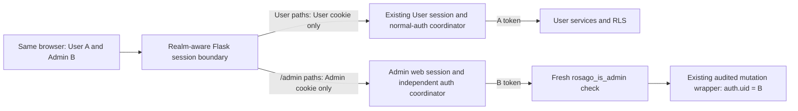

# Phase 2A — independent User and Admin sessions

**Design only. Proposed architecture: separate browser cookies, server-side session namespaces and route-specific authentication contexts, with the existing audited Admin authorization contract retained.** No implementation, production request, SQL, Auth setting change, cookie change, dependency installation or deployment occurred in this phase. Phase 1D remains deferred; this work does not supply production write access.

## 1. Current implementation and the cause of account replacement

| Area | Inspected behavior |
| --- | --- |
| User authority | `normal_auth_flask.read_auth_session_id()` reads `session['auth_session_id']` from Flask's signed browser cookie. Identity/access/refresh credentials live in `NormalAuthStore`, not in that cookie. |
| Admin login | `admin_routes.login()` calls the **same** normal-auth adapters and `establish_normal_session()`. Establishment replaces the cookie handle and revokes the previous normal-auth record. |
| Admin access | `admin_auth.admin_required()` delegates to User `login_required`, which installs `g.auth` using that same handle, then calls database-backed `rosago_is_admin()` on its request-owned client. There is no independent Admin identity. |
| Logout | Both `/logout` and `/admin/logout` call `logout_normal_session()` and clear the shared Flask session. The User logout route has no explicit CSRF/origin validation; Admin logout has both. Logout is currently local store revocation, not Supabase global sign-out. |
| CSRF | Admin pre-login token/timestamp are in the shared signed Flask cookie. Authenticated Admin forms use the normal-auth record's CSRF. User trip/profile mutations likewise validate CSRF using their normal-auth record. User `/login` and `/logout` do not currently implement the synchronizer/origin checks used by Admin login/logout. |
| Identity verification | `SupabaseAdapters.password_login()` verifies password sign-in with SDK get_claims/get_user, binds subject/session IDs, requires confirmed email and password-only AMR. Refresh preserves the verified user and Supabase session ID. Each operation owns its SDK/HTTP client; automatic refresh and persisted SDK sessions are disabled. |
| Expiration | `NormalAuthStore` enforces 30-minute idle and 8-hour absolute lifetimes with a monotonic clock. Resolution alone does not touch activity. Coordinator resolution/client construction touches activity and reserves refresh with generation/nonce protection. Access-token expiry is separately Unix-time metadata. |
| Recovery | Pending PKCE and recovery grants have their own process-local stores and opaque references in the User Flask session. Recovery uses verified recovery claims, not normal login authority, and redirects to User login after reset. The shared SDK is avoided during exchange/reset. |
| Runtime limits | Authentication, refresh reservations and recovery state are process-local. Workers do not share them; restarts lose them. Cookie configuration explicitly sets `SESSION_COOKIE_SECURE=False`, with a local-HTTP comment. These are existing limitations, not solved by adding a cookie. |

The current test `test_login_success_uses_normal_session_then_fresh_membership` explicitly expects Admin login to leave a normal auth_session_id. Other Admin tests seed normal sessions. These expectations must change deliberately; they cannot remain regression acceptance criteria for independent sessions.

## 2. Session boundary and request routing

Keep User URLs and the existing signed User cookie name/path/signing behavior. Introduce a **realm-aware Flask SessionInterface**, installed once at startup:

- For `/admin` and `/admin/...`, open an Admin server-side browser session using only the new Admin cookie. Ignore the incoming User cookie. Save only Admin state/cookies, including flash messages, login-CSRF state and errors.
- For every other path, delegate to the existing User secure-cookie implementation. Never resolve or save Admin authority on a User request, even if a forged request sends that cookie manually.
- Select the realm from Flask's normalized request path using the exact `/admin` boundary, including bare `/admin`. `/administrator` is not Admin. Endpoint resolution occurs after session opening, so endpoint names alone are insufficient. Preserve the selected realm through errors, redirects and response saving. Define and test mount-prefix/cookie-path handling before any non-root deployment.
- Do not mutate global app cookie settings per request. The dispatcher and its adapters have immutable configuration and choose the appropriate save/open implementation.
- Admin processing must not load/modify/reissue the User cookie through `flash`, `session.clear()`, login-CSRF writes or automatic session refresh. A second auth key in the existing cookie alone is insufficient: concurrent responses and shared clear operations would still couple them.

Cookie paths reduce unnecessary cookie delivery; they do not create a separate security origin or protect against same-origin XSS. Browser cookies are shared across tabs for the same realm: this supports one User account plus one different Admin account, not arbitrary independent accounts in every tab.

## 3. Proposed cookie and storage contract

| Property | User realm | Admin realm |
| --- | --- | --- |
| Browser cookie | Existing Flask cookie, normally `session` | Production `__Secure-rosago_admin_session` |
| Payload | Existing signed User state containing opaque User auth handle and recovery/UI references | Only a cryptographically random opaque Admin browser-session handle; no JWT, refresh token, email, role flag or auth claims |
| Path | Existing root path | `/admin` for the current root-mounted app; include configured mount prefix if deployed differently |
| Domain | Existing host-only deployment is preferred; verify current effective setting | Omitted: host-only |
| HttpOnly | Retain true | True |
| Secure | True for production HTTPS; explicit local development exception | True for production; separate unprefixed development cookie for local HTTP |
| SameSite | Preserve Lax | Lax, with synchronizer tokens and strict mutation Origin checks |
| Cookie lifetime | Existing browser-session behavior | Browser-session cookie; server TTL is authoritative, not browser close behavior |
| Server auth authority | `rosago_normal_auth`, User store/coordinator | New `rosago_admin_auth`, physically separate store/coordinator instances |
| Server browser state | Existing User signed session | Separate Admin web-state store for pre-login challenges, flash and opaque auth reference |

Use at least 32 random bytes for new handles and independent random CSRF tokens. A missing, malformed, oversized, unknown or duplicated Admin cookie is not authentication. Bound input length and reject ambiguous same-name cookies rather than selecting a convenient value. Never create an authenticated record for an unknown browser-selected handle.

Admin pre-login web records contain only non-authority state, expire after 30 minutes, and are subject to capacity/rate limits. On verified and authorized login, allocate a **new** browser handle and new authenticated CSRF; bind it server-side to a newly created Admin auth-store handle. The auth credentials remain solely in the auth store, not in the Flask session mapping or generic web-state serialization. Browser and auth record lifecycles must be coordinated; resolving either expired/revoked side fails closed. Partial establishment revokes the new auth record and never overwrites the User realm.

Auth storage can reuse the existing store/coordinator algorithms through **separate instances**. Shared backend keys must include a mandatory realm, for example User-auth, Admin-auth and Admin-web namespaces with a hash/HMAC of the random handle. Realm comes from server configuration, never a cookie field, query parameter or submitted role. Keep credential records redacted; encrypt sensitive values at rest when using an external backend and restrict its access.

The `__Secure-` prefix is compatible with `/admin`; `__Host-` requires root Path and cannot be used with this proposed Admin path. These prefix requirements are documented in [MDN's cookie reference](https://developer.mozilla.org/en-US/docs/Web/HTTP/Reference/Headers/Set-Cookie). Configure the cookie name and HTTPS mode at startup, and fail startup for a production mode that requests an insecure Admin cookie.

## 4. Login, authority and audit attribution

Introduce explicit `admin_authenticated()`, Admin dependency lookup, Admin establishment/revocation and an Admin authentication-only decorator. Preserve `normal_authenticated()`/User login_required as User-only. Do not select whichever realm happens to be authenticated.

Proposed login sequence:

1. `/admin/login` examines only Admin web/auth state. A valid User A session, even for an account with Admin membership, never signs it into Admin automatically.
2. Validate the Admin pre-login synchronizer token, age, exact form fields and same-origin request. Retain provider error sanitization and throttling behavior. Add bounded pre-auth state allocation and application login rate limiting when implementing the new store.
3. Password-login B with the existing verified, request-owned adapter policy. Validate claims, confirmed email, token expiry, identity and Supabase session ID exactly as today.
4. Before publishing browser Admin authority, construct a request-owned client with **B's** verified access token and call existing `rosago_is_admin()`. A nonmember gets 403 and no authenticated Admin cookie/store record. Membership service unavailability gets 503 and no newly installed authority; User A and any prior valid Admin session stay unchanged. Discard candidate credentials securely. A provider login may have issued a candidate provider session even if membership is denied; never use global sign-out to clean it up.
5. On success, create/rotate only the Admin web/auth handles and CSRF. Revoke only the replaced Admin handles. Consume the login challenge once. Redirect to Admin and repeat membership verification on each protected request.

Use explicit request-local `g.admin_auth` on Admin routes. Keep `g.auth` as a User-only compatibility interface, optionally adding `g.user_auth` for clarity. Admin rendering must hide all authority objects from Jinja. Never put `g.admin_auth` into `g.auth` merely to avoid updating Admin call sites.

Add a server-assigned `realm` discriminator to the immutable AuthenticatedContext while keeping its existing exact type where services require it; default existing normal contexts to User and configure Admin coordinator output explicitly. Enforce Admin realm in `admin_authorization_service` and `admin_places_service._context`. User personal-route contexts remain User-only. Shared own-profile reads used by the Admin Account page may accept either verified realm deliberately; this must not cause User routes to fall back to Admin credentials. Document each shared service's contract rather than globally forbidding legitimate Admin own-profile reads.

All Admin reads/writes, uploads and audit directory reads receive B's Admin context. Retain the normal authenticated Supabase role and existing database-backed Admin membership checks. The existing destination wrapper derives `actor_id` from `auth.uid()`; neither the browser nor Python chooses an audit actor ID. No RPC signature, grant, RLS or audit schema change is needed. Concurrent User A activity cannot change B's request-owned bearer client.

## 5. Logout, CSRF and expiration

`/admin/logout` uses the Admin authentication-only scope, not membership authorization: a revoked Admin must still be able to log out. Validate Admin CSRF plus Origin, revoke only Admin auth/web state first, then expire only the Admin cookie using matching name/path/domain attributes. Preserve the User cookie and User recovery/UI state. Existing credential freshness failures may clear only the affected realm; transient busy/unavailable failures return retryable responses and must not clear the other realm.

`/logout` continues to revoke only User normal authority and clear User browser/recovery state according to its existing UX. Because its session interface is User-only, its clear operation cannot remove Admin authority or Admin flashes. Do not issue an Admin cookie deletion header from a User response. No sign-out of all Supabase sessions is part of either route. The installed Python Auth SDK defaults sign_out to global scope; [Supabase documents its cross-session effect](https://supabase.com/docs/guides/auth/signout). Preserve local server-side revocation for this change; any later provider session revocation needs an explicit local scope and separate design/testing.

CSRF design:

- Admin pre-login, authenticated mutations and logout use only their respective Admin server state. Rotate on login/account switch; an old Admin form must fail against a new Admin session. Never read `admin_login_csrf` from the User cookie after cutover.
- User authenticated mutations keep their User synchronizer token. A User token must be rejected on Admin routes and an Admin token on User authenticated mutation/logout routes, even if A and B are the same Supabase account.
- **Necessary targeted hardening:** User login and logout currently lack matching checks. Add a User pre-login synchronizer token in User state and authenticated User logout token/Origin validation; update all User logout form generators, including JS-created forms. Without this change, a cross-session token rejection test on User logout would be meaningless. Preserve User login redirects and logout UX while rejecting missing/foreign tokens. An anonymous/recovery-only cancellation path, if retained, needs a separate User pre-auth logout token and must never use a recovery grant or Admin token as normal authority.
- Preserve recovery-grant CSRF as a third purpose/namespace. Never accept it as User or Admin login authority or as an authenticated mutation token.

Use the current 30-minute idle/8-hour absolute policy for Admin initially. A User request never touches Admin activity, and vice versa. Keep access-token refresh thresholds, refresh identity/session binding, generation checks and fail-closed behavior. An expired Admin cookie cannot become valid through the presence of User A; it redirects only to Admin sign-in. Server lifetime remains authoritative if the browser restores a session cookie after restart.

## 6. Password recovery and provider policy

Retain existing root `/forgot-password`, reset callback and `/reset-password` flows, their PKCE verifier binding, replay reservation, recovery-only claims and one-use grant lifecycle. These remain a shared **account recovery** flow in the User browser-state realm; do not automatically create an Admin session after a reset. The existing Admin Forgot password link may continue to that flow, with copy explaining that Admin requires a separate sign-in afterward. User logout may clear its User-owned recovery browser state as today; it must not revoke an independently authenticated Admin session.

Do not add Admin reset callbacks, recovery-to-Admin promotion, or new redirect allowlist entries in this phase. If a future requirement demands an independent Admin-branded recovery flow, give it dedicated state, callback routing and purpose-specific grants in a later design.

Recovery must preserve User A's normal login while a pending/granted reset exists, as existing tests require, subject to provider enforcement when the password is actually changed. A password/security change for A can legitimately invalidate A's sessions; that must not locally clear unrelated account B's Admin session. If the same account occupies both realms, account-wide security invalidation may affect both. Do not suppress it to promise isolation. [Supabase's session documentation](https://supabase.com/docs/guides/auth/sessions) describes provider expiry and single-session policies; inspect actual settings read-only before rollout rather than changing them here. Distinct accounts A/B do not require relaxing single-session-per-account policy.

## 7. Concurrency, fixation and storage limitations

Cross-realm concurrency is isolated by separate cookies, separate server keys and separate refresh reservations. No request may rewrite the other cookie or mutate its namespace. Admin web-state saving must use atomic field operations or generation compare-and-swap; do not overwrite a whole stale session snapshot at response end or resurrect a deleted/revoked record. Preserve immutable request contexts, scoped client cleanup and bounded refresh waiting; do not automatically retry mutation requests.

Rotate browser/auth handles on successful authentication and account change; reject replayed pre-auth challenges. Do not promote a browser-supplied session ID. Logout/store revocation is authoritative before cookie removal; retained cookies must resolve to revoked/absent records. Tombstones/generation fencing or equivalent backend semantics must prevent a stale writer from recreating authority.

Flask notes that concurrent sessions have [no guaranteed open/save order](https://flask.palletsprojects.com/en/stable/api/#flask.sessions.SessionInterface). Only issuance, rotation and logout should emit the Admin Set-Cookie header; normal refresh, flash consumption and page reads should not continually reissue a stable cookie. Serialize competing login/logout transitions server-side where possible and disable duplicate UI submissions. A delayed same-realm response can still overwrite/delete a newer browser cookie; with fencing, it may cause reauthentication but must not revive old authority or affect the other realm. Do not promise browser-level compare-and-swap that HTTP cookies do not provide.

Logout cannot cancel an already-dispatched database request. Recheck lifecycle before dispatch, keep database membership/row locks, and report any in-flight completion according to its actual actor. Strict cancellation of an already-issued Supabase transaction would require a separate database/session-revocation design; it is not solved by cookie isolation or silently added SQL.

**Process-local mode is suitable only for a clearly limited single-process development/test implementation.** A second store instance does not make production durable or multiworker-safe. Production readiness requires a shared storage adapter for **both realms** plus Admin web-state and existing recovery stores, with atomic refresh reservation/replacement/revocation, capacity/TTL cleanup and an outage policy. Sticky sessions do not provide durable revocation or failover. Do not store process-relative monotonic timestamps unchanged in a shared service; use a shared absolute-time/TTL policy with bounded clock assumptions while preserving the 30-minute/8-hour semantics. Long-running refresh leases need generation fencing; simply expiring a lock while an old refresher continues can consume rotated tokens twice.

Backend selection/provisioning is a deployment decision still required. An external shared key-value/session backend avoids changing RosaGo's application database schema, but must be secured, encrypted as appropriate, monitored and tested. If a SQL session backend is chosen instead, it needs its own separately reviewed schema/migration; none is proposed or executed automatically here.

## 8. Affected files and implementation boundaries

| File/group | Proposed change |
| --- | --- |
| New `session_realms.py` | Immutable route/cookie dispatch; Admin server-side SessionInterface; strict cookie parsing and realm-tagged sessions; no per-request app-config mutation. |
| New `admin_session_flask.py` | Admin dependencies, pre-login lifecycle, authenticated scope, establishment, local logout and Admin-only CSRF helpers. |
| New `admin_session_store.py` | Admin browser-state store contract, separate instances/namespaces and CAS/revocation semantics; capacity/TTL controls. Credential-store algorithms may reuse the existing tested implementation. |
| `normal_auth_coordinator.py` | Server-assigned context/coordinator realm; preserve verification, refresh and client-lifetime algorithms. |
| `normal_auth_store.py`, `normal_auth_flask.py` | Explicit User-only contract and shared-backend interface seam; preserve normal credentials/recovery separation. Do not replace existing User behavior by an Admin fallback. |
| `admin_auth.py`, `admin_routes.py` | Replace normal-auth imports/decorators, `g.auth`, CSRF/store lookups, login/logout establishment and flash handling with Admin equivalents; remove User-session installation on non-Admin login. |
| `admin_authorization_service.py`, `admin_places_service.py` | Require verified Admin realm while retaining database membership and client-based services. Other Admin services inherit the corrected context boundary. |
| `app.py`, `auth_helpers.py` | Startup dispatcher/Admin registration; production cookie configuration; User-only normal helper guard and User login/logout CSRF hardening. Recovery flow logic remains intact. |
| `templates/admin/login.html`, Admin layouts/account pages and `static/js/admin.js` as needed | Separate sign-in/logout copy and tokens; independent-account explanation; no calls to User auth/status to infer Admin identity. |
| User login/logout forms, `static/js/user-ui.js`, affected navigation templates | Supply User-purpose CSRF in static and dynamically created forms; preserve redirects/identity UI. Public theme storage can stay shared because it is not authority. |
| `profile_service.py` and personal-service boundaries as needed | Make explicit which verified realms shared own-profile reads accept; User personal operations must never resolve Admin authority implicitly. |
| Existing Admin/auth/recovery tests plus new realm tests | Separate seeding helpers and same-browser cookie tests. Existing Admin seed-normal-session expectations must be replaced, not bypassed. |
| Deployment docs/configuration | Explicit HTTPS cookie mode, host/mount policy, worker/backend configuration, secrets handling and production rollout gates. |

There is no planned change to migrations 0008/0013/0014, destination mutation signatures, audit attribution SQL, Admin memberships, public catalog RLS, photos or Environment behavior. The existing publishable Supabase key remains sufficient for verified user-token clients. No service key or additional role is needed.

## 9. Configuration and migration strategy

Proposed configuration responsibilities—not current environment changes—are production HTTPS enforcement, fixed Admin cookie name/path/domain policy, 30-minute/8-hour Admin TTLs, pre-auth capacity/rate limits, and shared-session backend settings before multiworker deployment. Keep the existing Flask signing secret stable to preserve User/recovery cookies. Do not repurpose the Environment feature flag. Production secure-cookie enablement is a deliberate reviewed configuration correction, including trusted reverse-proxy/host handling; never trust arbitrary forwarded headers.

Concrete proposed deployment inputs are `ROSAGO_AUTH_MODE=development|production`, `ROSAGO_SESSION_BACKEND=memory|shared` and, only for the selected shared adapter, a secret `ROSAGO_SESSION_BACKEND_URL`. These names are **new design proposals**, not settings the existing app already reads. Production mode must require HTTPS Secure cookies and a validated backend/topology; memory mode must be explicitly limited to single-process testing. Cookie names/path and TTL defaults can remain validated startup constants unless deployment needs overrides. Configure trusted hosts/proxy hops for the actual hosting setup; do not derive security mode from an arbitrary incoming header. Local HTTP development uses its separate unprefixed Admin cookie name. Cookies are not isolated by TCP port, so multiple development app instances on the same hostname also need deliberately distinct cookie names or hostnames.

Rollout sequence after implementation approval:

1. Implement and run the offline/browser matrix in TEST-PLAN.md with synthetic accounts. Introduce no production mutation test or implicit account provisioning.
2. Verify HTTPS/cookie scope, actual Supabase session policies and intended worker/backend topology read-only. Either deliver the shared backend for production or label any process-local rollout as single-process limited testing; do not claim multiworker readiness.
3. For in-process stores, use a coordinated restart without mixed old/new workers and state that both realms' process-local sessions/recovery grants will be lost. A seamless User-session migration is not possible across a restart with the current in-memory store. Preserving live sessions requires an explicitly implemented shared-store transition; this design does not pretend that exists.
4. Deploy realm enforcement consistently. Existing User handles remain User-only; an old shared Admin login is never auto-promoted into the new Admin namespace. Users previously signed in through Admin may still have a User session, but must explicitly sign in again for Admin. Ignore legacy Admin-CSRF keys in the User cookie rather than modifying that cookie from an Admin response.
5. Old tabs/forms fail closed and reload into the correct realm. Verify simultaneous A/B login/logout/refresh with already approved accounts; any production business-data write test still requires its own authorized disposable fixture and checkpoints.
6. Rollback must not silently re-enable shared-cookie Admin authorization. Keep Admin routes closed or serving a maintenance response while retaining User routes if independent Admin support must be removed. Revoke/expire only new Admin handles where possible. A full process-local restart also loses User sessions and must be reported. Returning to old shared Admin behavior requires a separately approved compatibility decision and explicit reauthentication, not automatic cookie conversion.

No RosaGo database migration or Supabase Auth schema/settings change is inherently required for two distinct accounts in one browser. Shared-store infrastructure and cookie/HTTPS deployment configuration are necessary for a robust production deployment. Existing provider policies can limit session independence for the same account; review them rather than weakening them.

## 10. Decision and remaining risks

The proposed design meets simultaneous User A/Admin B isolation at the browser, store, request-client and CSRF boundaries while retaining database Admin authorization and audit actor derivation. The remaining implementation gates are the test matrix, User login/logout CSRF hardening, production HTTPS configuration, and shared-storage/topology selection. Same-origin XSS, already-dispatched writes and provider account-wide security revocation are not eliminated by separate cookies.

**Ready for architecture review and implementation approval, not implemented or production-verified.** No production access restriction was bypassed, and Phase 1D remains deferred.
