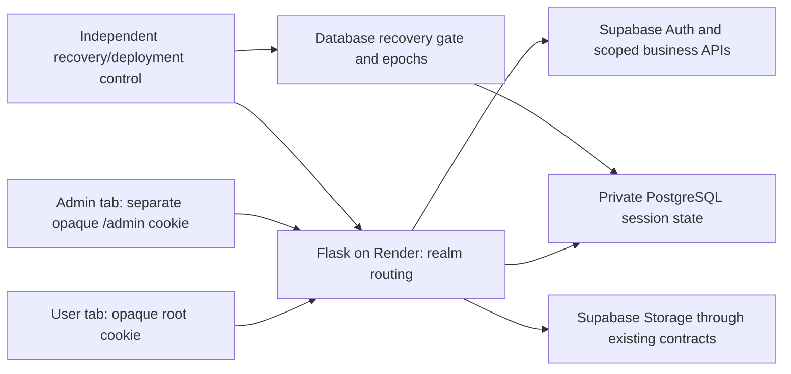

# Phase 2L — simplified session architecture and feasibility review

**Recommendation: one transactional session store in Supabase PostgreSQL, retaining Supabase Auth/Storage and independent opaque User/Admin cookies, with enforced recovery invalidation. GO for a separately approved, staged isolated implementation of that candidate. NO-GO for activation or production deployment.** All eight production gates remain FAIL. Render Free is technically usable for a demonstration, but is not a production-readiness approval.

The simpler store removes Redis, local LMDB and the custom protected-authority API from the proposed production data path. It does **not** remove the need for trustworthy recovery control. PostgreSQL can safely commit a revocation and later restore an older backup containing that session. Render deploy rollback can also restore old application configuration. Both risks must be addressed before release.

Only this review directory was added. Existing Redis, LMDB, authority, authentication, dependencies and business implementation remain unchanged. No production SQL, tables, Supabase data/Auth/Storage, feature flags, deployment settings or sessions were touched. The startup safeguard remains enabled. Nothing was staged, committed, pushed or deployed. SQL executed in this phase was limited to a disposable **network-disabled local PostgreSQL container**, not Supabase.

## 1. Current architecture assessment

The current server separates User and Admin identity through separate opaque cookies, realm-selected Flask sessions, independent CSRF/authentication state and scoped Supabase clients. Mutable User browser state is already server-side. Fresh Admin membership and B's JWT remain the authorization/audit boundary. Those behaviors should be preserved.

The storage path is more complex than the expected student workload justifies: encrypted Redis records, a protected-authority interface, historical LMDB/witness implementations and an unresolved independent freshness/recovery control plane. Phase 2J intentionally closed the default shared factory without explicit protected-authority injection. Production initialization still refuses activation; development memory mode is local-only.

Phase 2K passed 49 positive checks but demonstrated two unsafe recovery procedures: a new worker accepted an old authority snapshot with an old floor, and adopting a new service identity without new realm epochs restored a revoked session. Its tested mTLS interface required five authority RPCs per lookup and nine per activity update. These measurements are historical interface evidence, not a Supabase performance forecast.

No Render blueprint, Procfile or Gunicorn startup configuration was found in the reviewed root. There is no existing PostgreSQL session driver/backend to configure. In particular, `app.py` defaults a missing auth mode to development; a future production launcher must reject that default rather than silently select memory. This review does not alter it.

## 2. Proposed simplified architecture

This is a proposal, not installed infrastructure. Supabase remains the identity provider; the database stores RosaGo's browser-session authority and temporary workflow state. Existing business mutations continue through the authenticated Supabase client, not the session-store SQL role.

Use a private schema with no browser/anon/authenticated Data API access and a dedicated least-privilege server login. The runtime role must not administer backup/restore, modify Auth/Storage/business tables, change membership, edit recovery epochs or bypass business policies. A separately authorized operator owns schema/control changes. Do not use the project `postgres` credential as the application session role.

Logical record families, all in the **same transactional database**, are:

| Family | Required behavior |
| --- | --- |
| Recovery gate | Protocol/namespace, controlled User/Admin epochs, OPEN/BLOCKED/QUALIFYING state; no automatic approval from restored data. |
| Credential sessions | Realm, epoch, hashed random reference, verified provider subject/session identity, encrypted tokens/CSRF, version, activity/absolute deadlines, revoked state and refresh reservation. |
| Browser sessions | Realm/epoch-bound hashed reference, encrypted mutable browser values, field/version control and a same-realm credential binding. Generic browser saves cannot install credentials. |
| CSRF/login challenges | Browser/realm/purpose binding, expiry and atomic one-time reservation/consumption. |
| PKCE/recovery/verification | Encrypted verifier/grant/code state, independent deadlines, reservation owner, consumed/busy fences and replay markers. |
| Rate limits/operation receipts | Bounded per-purpose counters and fixed expiries; short-lived receipts reconcile uncertain commits without repeating provider calls. |

These are conceptual families, not approved table names, DDL or production schema. Indexed composite identity should include namespace, realm, epoch, family and reference digest. Enforce same-realm/epoch browser-to-credential relationships. Keep arbitrary User JSON from changing auth bindings, roles, subjects or versions.

Reuse the existing bounded JSON/AES-GCM codec after testing a new PostgreSQL protocol/AAD context. Sensitive values stay encrypted; cookies contain only unpredictable 256-bit references. Bind ciphertext to protocol/namespace/realm/epoch/family/reference/key ID. Logical deadline/version columns remain database-authoritative. Never use pickle or place provider credentials in browser storage/cookies/logs.

### Transaction contracts

| Operation | Proposed atomic database behavior |
| --- | --- |
| Resolve/authorize | Read current gate plus matching browser/credential state, realm/epoch, revocation and deadlines in a consistent operation. No positive authority cache; backend/gate failure returns unavailable. |
| Login/rotation | Validate the reserved browser-bound challenge and parent version; create new opaque credential/browser references, invalidate old same-realm parents and consume the challenge in one transaction. Only verified server-side credentials may enter this operation. |
| Logout/revoke | Atomically mark/remove same-realm authority and browser binding, increment/fence its version and record the result if needed. Acknowledge after commit. Other realm is untouched. |
| Refresh | Reserve with expected version/generation and owner/deadline, commit, release connection, then call Auth. Finalize in a new transaction only for that current owner/version/subject/provider session. An uncertain/expired reservation burns authority; never repeat a possibly consumed refresh token automatically. |
| Browser save | Versioned update/controlled field merge; no UPSERT that recreates revoked authentication. Never let stale form/browser state restore an auth binding. |
| Recovery/verification | Short reservation transaction, provider call outside the transaction, conditional finalize/consume. Cross-purpose/realm replay denied; uncertain provider results require a restarted flow. |

Lock record groups in a stable order, recheck gate/deadlines after waits, use bounded statement/lock/connection timeouts and reject stale expected versions explicitly. Keep provider HTTP and photo/business calls **outside** session transactions. Separate PostgREST HTTP calls are not one multi-statement transaction; either use a direct driver transaction or a separately reviewed narrowly scoped atomic API, not ad hoc REST reads followed by writes.

PostgreSQL's documented isolation behavior supports row-lock/conditional-update designs, but the implementation must choose and test its lock/isolation rules. Deadline checks must use current time after relevant waits; transaction-start time alone can be stale in a long transaction. [PostgreSQL transaction isolation](https://www.postgresql.org/docs/current/transaction-iso.html), [PostgreSQL time functions](https://www.postgresql.org/docs/current/functions-datetime.html).

## 3. Independent User/Admin session design

Preserve the current cookie contract: `__Host-rosago_user_session`, host-only, Path `/`; `__Secure-rosago_admin_session`, host-only, Path `/admin`; both Secure, HttpOnly, SameSite=Lax over HTTPS. Route selection, not cookie Path alone, establishes authority. Admin requests ignore User credentials even if the root cookie is physically sent; User routes never use the Admin handle. Reject duplicate, malformed, legacy and opposite-realm references.

User A/Admin B share the database infrastructure, not auth records, browser state, CSRF secrets, refresh leases or ordinary logout. One realm's activity must not extend the other's deadlines. Preserve User login/logout CSRF, independent Admin CSRF, fixation-resistant rotation, Origin/Host checks and the existing recovery browser/purpose rules. Password reset/verification remain User flows and never promote a User login into Admin.

Continue the reviewed 1,800-second credential idle / 28,800-second absolute bounds, 600-second recovery limits and existing per-family challenge/verification/rate deadlines unless a later explicit review changes them. Reads must not reset auxiliary TTLs. Physical cleanup may lag; logical expiry always denies access. Do not depend on an in-process timer or background thread surviving Render sleep. Plan bounded database-side scheduled cleanup or a reviewed external scheduler, with retention/admission limits.

Fresh database-backed Admin membership remains mandatory. Destination/photo/Environment/audit operations must use **Admin B's scoped Supabase client/JWT**, so `auth.uid()` attribution remains B. The new SQL session role must never call those business RPCs as a substitute, accept an actor from client JSON, or inherit User A's client. No audit SQL, grant/policy or destination contract change is part of this design.

Provider-wide security events can legitimately affect multiple sessions; ordinary realm logout must not accidentally perform provider-global sign-out. Supabase documents distinct sign-out scopes and that issued access tokens may remain valid until expiry. RosaGo's local revocation does not recall an already issued context/JWT or an already dispatched business request. [Supabase sign-out](https://supabase.com/docs/guides/auth/signout).

Server-side state prevents stale response bodies from rewriting newer server authentication. Late Set-Cookie responses can still replace a browser's newer same-realm handle with an invalid old handle, requiring sign-in; disclose/test both response orders. Do not claim the database controls browser network ordering or add a cross-realm logout fallback.

## 4. Revocation, recovery epochs and rollback safety

**A transactional database solves local atomicity, not arbitrary snapshot freshness.** A backup can contain an unrevoked credential, an OPEN gate and an old matching epoch. Restoring all of them can revive the session. Sequence numbers stored in that same backup have the same limitation. Fresh encryption keys/identity strings alone do not establish correct recovery.

The proposed recovery contract is:

1. Normal application/worker restart retains the same current epochs and durable state. Do not clear all sessions or generate a per-worker epoch on every Render boot.
2. Before database restore, uncertain failover or incompatible authority recovery, independently close protected traffic, stop/fence old workers and drain/reconcile in-flight provider/business operations.
3. Establish current recovery control outside the restored database. If intact acknowledged state cannot be proved, choose new never-used User/Admin epochs or namespace; do not import old handles. A new server identity/control generation without new record contexts is insufficient.
4. Put the database gate into QUALIFYING under the new epochs. Start only compatible workers pinned to the independently current expected epochs. Each operation must compare that expected state with the database gate; mismatches deny access. No startup auto-adoption of the epoch found in the database.
5. Validate and OPEN only after the controlled recovery checks. Require separate User/Admin sign-in; reset incomplete PKCE/CSRF/verification flows. Keep audit history and all business records; do not restore business data to fix a session problem.

An epoch merely stored in another mutable file is not automatically protected. For arbitrary rollback including both the database and every application/control snapshot, independent monotonic control is still required. If provider recovery can silently serve an older acknowledged state before an enforceable gate detects it, production remains NO-GO. A manual after-restore invalidation step leaves an unsafe window and is insufficient by itself.

### Important Render rollback finding

Render documents that a deploy rollback can use the target deploy's **service environment variables**. Environment-group values are not themselves rolled back, but the groups associated with a service can change. Therefore a service-local epoch/keyring variable is not an independent freshness anchor. An environment group may be a useful separately controlled recovery input, but current values, group association, permissions and old-release behavior must be enforced and rehearsed; it is not inherently monotonic. [Render rollback configuration](https://render.com/docs/rollbacks).

Until this is qualified, prohibit one-click rollback to an old auth configuration. Use a separately approved compatible release with the **current** recovery configuration, or maintenance. Restrict restore/gate-opening permissions and ensure old workers cannot rejoin. Supabase's project backup/restore and Render's code/config rollback are different operations and must be tested together. Paid backups improve recovery capability, not session freshness. [Supabase backup behavior](https://supabase.com/docs/guides/platform/backups).

### Isolated PostgreSQL proof of concept

[transaction_poc.py](transaction_poc.py) ran only inside `--network none`, with no published port, real account, Supabase connection, application adapter or production tables. It used the downloaded official image pinned to `postgres@sha256:653186fe15006c099d2fb3bc1d8461c1dee9d036c43f2e5fdaf4f22e5e601876`, reporting PostgreSQL **17.11**. The dump stayed in memory and was restored to a second disposable database in that same owned container.

**17 positive checks passed; two unsafe restore models were reproduced.** See [poc-results.json](poc-results.json).

| Case | Result and limit |
| --- | --- |
| Same reference digest in different realms; independent logout | PASS: composite identity/revocation stays realm-scoped. |
| Two concurrent PostgreSQL refresh reservations | PASS: exactly one owner. |
| Revocation holds row lock while late refresh CAS waits | PASS: late predicate is rechecked after revocation and updates no row. |
| Rotation commit vs rollback | PASS: no partial replacement on abort; old invalid/new valid on commit. |
| Expired row / delayed transaction time / challenge consumption | PASS: logical expiry, current-time distinction and one-time update semantics. |
| Old database dump includes both credential and database-local gate | **FAIL:** revoked session becomes valid again under the old expected epoch. |
| Independent expected epoch is newer than restored gate | PASS, closed: mismatched state grants nothing; requires controlled recovery. |
| Application expected epoch also rolls back | **FAIL:** matching old configuration restores acceptance again. This models the Render configuration risk; Render itself was not deployed/tested. |
| QUALIFYING → new epochs → OPEN | PASS: old User/Admin handles stay invalid; only new-epoch state is usable. |

The proof is **not** a complete session schema/adapter, encryption integration, Auth/CSRF workflow, least-privilege role, Supavisor, TLS, Render, crash/failover or production-performance test. It runs as operator inside a private container and stores only synthetic session-control markers, not provider tokens. No production DDL/migration was written. It supports feasibility of SQL transaction semantics; it does not close G14 or certify the proposed architecture.

## 5. Supabase and Render compatibility

### Supabase PostgreSQL access

Use a server-only direct PostgreSQL driver with a small per-worker pool. Supabase's IPv4 shared pooler avoids assuming direct IPv6 reachability. Candidate transaction mode on port 6543 suits short explicit transactions; session mode on 5432 is a fallback for a persistent backend with carefully bounded connections. Obtain the exact project/role endpoint during an authorized configuration phase, not by guessing a region hostname. Transaction mode requires disabling unsupported prepared statements/pipelining and avoiding session-level state. [Supabase connection modes](https://supabase.com/docs/guides/database/connecting-to-postgres).

All row locks and transaction-local settings must live inside the transaction/connection that uses them. Do not rely on session advisory locks, temporary tables, LISTEN/NOTIFY or a server session variable persisting between pooled transactions. Qualify the chosen driver's actual pooler behavior, commit errors and stale-socket recovery. No driver was installed or connected in this review. Use certificate/hostname-verified TLS where supported, with an approved CA and endpoint; encryption-only configuration is not equivalent to hostname verification. [PostgreSQL TLS verification](https://www.postgresql.org/docs/current/libpq-ssl.html).

Connection budgeting must distinguish app/pooler clients from actual database backends. Bound the peak as `live release generations × instances × workers × per-worker maximum connections`, including overlapping old/new deploys. For example, one instance, two workers, max two connections each and two overlapping releases permits **eight app client connections**, not eight guaranteed free database backend slots. Supabase Auth, Storage, PostgREST and administration consume capacity too. Client and backend ceilings differ; current project limits are uninspected. [Supabase pool limits](https://supabase.com/docs/guides/database/connecting-to-postgres/pooling-and-limits).

Start with one measured worker and a small bounded pool (candidate max two, zero unnecessary overflow), then add worker/thread capacity only after RSS/latency/queue tests. Create pools after worker fork; do not inherit open database sockets. Reconnect/validate dead sockets after sleep without replaying an ambiguous transaction/provider call. Never hold a pool slot while waiting for user input or a provider API.

### Render Free

Render states that Free web services sleep after 15 idle minutes, can take about a minute to wake, may restart, lose local files and cannot attach persistent disks or scale beyond one instance. Free limits also include shared monthly hours, no one-off jobs/shell access and possible suspension for unusually high service-initiated external traffic. Render advises against Free for production. Supabase-backed durability avoids local-file loss, but not these availability/operational limits. [Render Free limitations](https://render.com/docs/free).

One platform instance can still run multiple Gunicorn workers; that does not make local Python dictionaries or locks shared. The candidate database backend supports process independence conceptually, but actual worker memory, endpoint connectivity and pool exhaustion must be tested on the chosen tier. Do not assume two workers fit the full application's imports. No deployment start command or worker count was changed.

Ordinary sleep/restart should preserve valid database sessions and pending workflows until their original deadlines, with stable keys/epochs. A 15-minute sleep plus wake delay may leave an existing 30-minute idle session valid; a longer idle interval may expire it. Do not extend security TTLs to compensate for hosting sleep. A lost database connection is unavailable, not permission to reconstruct auth from a cookie or local cache.

Do not host LMDB, SQLite, sessions, recovery grants or uploaded photos on Render's ephemeral disk. Storage remains in Supabase Storage. Bounded database cleanup/admission must not depend on a sleeping Flask thread. A future public endpoint needs HTTPS/trusted hosts and exact proxy trust; no deployment-specific TLS/proxy assumption has been qualified here.

### Hosting cost and practicality

Using an existing Supabase project can avoid an additional cache and authority-service bill if capacity suffices; actual incremental cost is unknown. Supabase currently lists Free at $0 with 500 MB database capacity and inactivity pausing, and Pro from $25/month with the first project included. These are public list prices checked 2026-11-05, not a review of RosaGo's billing or a guarantee of the required availability/recovery controls. [Supabase pricing](https://supabase.com/pricing).

Render Free plus Supabase Free is a plausible constrained capstone demonstration, **not** a blanket production-compatible hosting claim. A stable production availability target may require paid compute/database capacity and monitored recovery. The simplified design remains portable to paid Render without changing the session security model. Do not add an always-on keepalive system to conceal Free limitations or promise an SLA that was not purchased/qualified.

## 6. Security risks and mitigations

| Risk | Required mitigation |
| --- | --- |
| Consistent old DB/config revives revocations | Independently current recovery input, pre-use fencing, new epochs after uncertain recovery and compatibility-controlled rollback. Still a release blocker. |
| Anonymous/browser access to encrypted session tables | Private schema, dedicated minimal server role, no browser Data API access; review grants/RLS and unauthorized-role probes before any production migration. |
| Admin actor changes because SQL role replaces B's JWT | SQL connection is for session state only. Preserve B's scoped business client, fresh membership and existing audit wrapper. |
| Stale refresh/login/save overwrites logout | Expected versions/owners/generations, atomic parent invalidation, no credential UPSERT or generic auth-field merge; burn uncertain provider operations. |
| Long lock wait passes an old deadline | Recheck current DB time after locks, bounded transactions and explicit timeout handling; provider calls outside locks. |
| Key/cookie/config rollback | Secret-management and predecessor-reader plan, current recovery configuration outside restored snapshots, correct cookie prefixes/deletion attributes; no tokens in browser storage/logs. |
| Recovery/CSRF/rate state stays in memory | Move all relevant families into the same durable store with independent TTLs and atomic consumption; preserve browser/realm/purpose checks. |
| Pool/CPU/disk/flood exhaustion | Small bounded pools, quotas/size caps, rate limits, reserved ability to revoke, logical expiry plus bounded cleanup; fail closed and monitor. |
| Malicious/unknown database restore during active traffic | No transparent acceptance; enforce independently controlled gate/provider guarantees. If this cannot be demonstrated, remain NO-GO. |

## 7. Reuse, replacement and manageable migration phases

| Existing module/component | Proposed future treatment |
| --- | --- |
| `normal_auth_coordinator.py` | Reuse verified credential/provider parsing, scoped clients, CSRF validation and refresh ownership concepts; test against new store protocol. Do not retain process-local authority fallback. |
| `normal_auth_store.py` | Reuse record/reservation types and expiry rules; replace memory implementation in shared mode with PostgreSQL adapter. |
| `redis_session_flask.py` | Reuse/extract realm browser-session, cookie and login/logout invariants; replace its Redis imports/transaction plumbing via a neutral store protocol. Not drop-in reuse without refactoring/testing. |
| `session_crypto.py`, `user_csrf.py` | Reuse codec/size/purpose rules, with reviewed PostgreSQL AAD/new protocol and keyring tests. |
| `normal_auth_flask.py`, `admin_session_flask.py` | Preserve routing/authority/actor semantics; inject the new store instead of hard-coded `RedisModel`. |
| `session_realms.py`, `session_readiness.py`, `app.py` | Future explicit backend/dependency wiring and real deployment validation. Production refusal stays until separate release approval; do not default deployed mode to development. |
| `recovery_helpers.py`, `email_verification.py` and recovery/verification routes | Preserve provider/security behavior; inject shared PostgreSQL family adapters for all mutable state. |
| `record_session_store.py`, `redis_session_store.py`, `session_authority.py`, `protected_session_authority.py`, local witnesses | Leave unchanged now. Later remove from the selected production path, retaining historical tests/evidence until a separately approved retirement. |
| Membership, destination/photo/Environment/audit/business services and SQL | Reuse unchanged; no new schema dependency or actor-grant change for business operations. |
| Existing regression suites | Reuse as behavioral contracts; add real PostgreSQL/pooler tests, avoid counting old unsafe local mechanics as new-backend qualification. |

### Proposed implementation phases — each separately reviewable

1. **Approve contracts and recovery assumptions.** Resolve prototype vs production hosting, current Supabase plan/limits, restore/operator ownership, Render rollback/environment-group policy and enforceable freshness source. Define fail-closed behavior if that source is absent. No production changes.
2. **Isolated store adapter.** Add an inactive PostgreSQL store/driver and isolated schema/role fixtures. Implement atomic create/resolve/rotation/revocation/browser CAS and deadlines with parameterized SQL. Preserve existing implementation and startup safeguard; no production tables or automatic migrations.
3. **Isolated workflow integration.** Inject User/Admin, CSRF, recovery, verification, receipts/rates through neutral interfaces. Pass both login orders, independent logout/expiry, stale responses, crash/commit uncertainty, nonmember/membership outage and B-actor contracts. Keep all destination/photo/audit logic unchanged.
4. **Render/Supavisor staging qualification.** Use separately approved isolated services, actual TLS/pooler/driver, worker/resource bounds, sleep/restart behavior and backlog limits. Rehearse database restore plus Render code/config rollback, including old-group/old-worker denial and mandatory reauthentication.
5. **Production preparation review.** Prepare additive private-schema migration/preflight/postflight, minimal role grants, current configuration, backup/cleanup policy, monitoring and a compatible maintenance/rollback build. No execution/deployment implied. Resolve all production gates before release authorization.
6. **Separately approved cutover.** Gate/drain, use new backend protocol/namespace/epochs, require independent fresh logins and restart in-progress recovery/verification. Do not copy legacy live sessions or provider accounts. Persisted profile/business data stays untouched; some browser-only transient preferences may reset. Roll back only to a compatible new-store release or maintenance, never to shared-cookie Admin/memory authority.

No schema migration, driver addition, alternative backend, Render service, configuration or cutover was implemented by this phase.

## 8. Updated production gates

| Gate | Status / evidence still required |
| --- | --- |
| G04 — HTTPS/hosts/proxy | **FAIL** — target Render hostname/proxy/cookies/private data access and browser acceptance unqualified. |
| G06 — keys/secrets | **FAIL** — actual keyring/DB role/secret delivery and rotation/rollback controls unqualified. |
| G12 — startup/readiness | **FAIL** — safeguard preserved; proposed PostgreSQL factory, recovery gate and production launcher not implemented. |
| G13 — multiworker/recovery | **FAIL** — local PostgreSQL transaction feasibility only; no Flask/Render/Supavisor sleep/restart or rolling-deploy acceptance. |
| G14 — durable revocation | **FAIL** — transactional revocation works locally, but DB/config restore counterexamples remain unsafe without enforceable independent recovery control. |
| G17 — operational configuration | **FAIL** — current Supabase capacity/roles/backups, pooler/driver, cleanup, alerts and recovery responsibilities unqualified. |
| G18 — faults/SLOs | **FAIL** — no measured hosted connection/clock/resource bounds, full request latency, quotas or provider failover qualification. |
| G20 — rollout/rollback | **FAIL** — no approved implementation/cutover/compatible rollback; Render environment rollback needs explicit protection. |

## 9. Decision and evidence limits

**GO for staged isolated implementation of the single-PostgreSQL candidate after approval. NO-GO for enabling a new backend, production tables, production deployment or declaring Render Free production-ready.** The simplest suitable target is one durable state store plus the existing Auth/business stack and an enforced recovery-invalidation contract—not a new chain of local witnesses. If recovery control cannot satisfy the existing freshness requirement, the correct result is to remain closed rather than weaken it.

Local proof establishes selected SQL atomicity/race/expiry properties. It does not establish SQL privileges, Supabase connectivity, encryption/Auth integration, hosted durability or the independent control boundary. Full Python/JavaScript/browser suites were not rerun because no runtime code changed. All 17 Phase 2J source/test/dependency fingerprints and three SQL byte fingerprints remain unchanged; see [verification-summary.json](verification-summary.json).

Added artifacts only: this `REPORT.md`, `transaction_poc.py`, `poc-results.json`, `verify_evidence.py` and `verification-summary.json`. The owned local PostgreSQL container/anonymous volume and temporary generated password file were removed; no database dump or secret was archived. The downloaded official PostgreSQL image remains cached locally. Stop pending approval.
