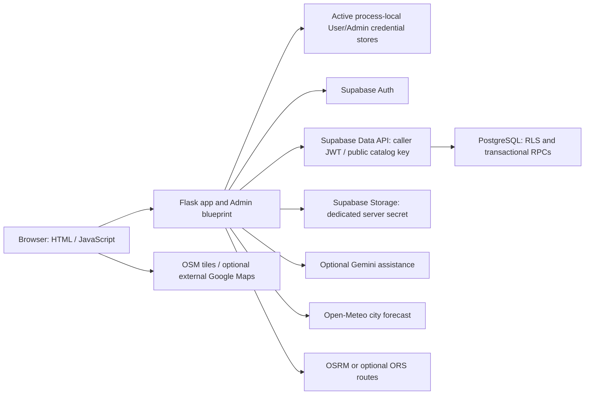

# RosaGo — Production Deployment Readiness Audit, Phase 1

Audited **2026-11-06 (Asia/Manila)** against the current working tree, including existing uncommitted work. **Decision: NO-GO for a public authenticated deployment.** This is an audit and implementation plan, not deployment authorization.

## 1. Executive summary

RosaGo has substantial implemented functionality and useful security controls. Published destination browsing, deterministic itinerary planning, optional AI assistance, profiles, trips, Admin destination management, photo validation, and audit-log contracts have offline coverage. Independent User/Admin authentication and logout work with synthetic providers. The fresh audit run completed **1,079 passing Python tests, one skipped external-workbook test, zero failures/errors**, plus **10 passing JavaScript fixture files**.

That evidence does **not** establish a production-ready website. The active authentication system uses process-local credential stores. Restarts discard sessions and pending email/recovery state; multiple workers cannot share them. Explicit production mode correctly refuses startup. The PostgreSQL candidate remains inactive and has no qualified production recovery authority. Earlier restoration experiments demonstrated revoked-session resurrection; their underlying security issue remains open. Neither this audit nor a successful manual login resolves it.

Other release blockers include localhost-only email redirects, unqualified SMTP and hosted policies, incomplete public abuse controls, missing production server/configuration, unqualified logging and recovery operations, and unverified live end-to-end integrations. The optional OpenRouteService branch also targets a hostname its operator has deprecated.

**Architecture decision:** Flask + Render + Supabase Auth/PostgreSQL/Storage is suitable in principle. Retain that stack and the earlier preference for a single transactional PostgreSQL session store. First qualify the recovery/release boundary and its threat model; then integrate production sessions. Do not introduce another Redis/LMDB/authority experiment or Windows PID-verifier phase. A paid host alone fixes none of these application-security blockers.

## 2. Scope, evidence and limits

Evidence labels throughout this report:

- **Confirmed now:** inspected current source or fresh offline results.
- **Historical:** saved prior observations, explicitly not rerun against hosted services.
- **Unverified:** requires provider configuration evidence, actual database enforcement, or separately authorized integration testing.
- **Proposed:** configuration, fixes, budgets and acceptance criteria requiring later approval.

Reviewed the reports and conclusions in [2L](../../admin-finalization/phase2l-simplified-session-review/REPORT.md), [2M](../../admin-finalization/phase2m-postgresql-session-implementation/REPORT.md), [2N](../../admin-finalization/phase2n-recovery-invalidation/REPORT.md), [2O](../../admin-finalization/phase2o-deployment-decision/REPORT.md), [2P](../../admin-finalization/phase2p-recovery-boundary/REPORT.md), [2Q](../../admin-finalization/phase2q-local-demo-readiness/REPORT.md), [2R](../../admin-finalization/phase2r-live-integration-verification/REPORT.md), [2S](../../admin-finalization/phase2s-live-demo-preparation/REPORT.md), the [controlled-verification report](../../admin-finalization/phase2t-controlled-verification/REPORT.md), the [live-test plan](../../admin-finalization/phase2t-stage2-live-test-plan/REPORT.md), and [Stage 2I's final strategy decision](../../admin-finalization/phase2t-stage2i-listener-diagnostic/REPORT.md). Cross-checked the principal findings against active source, migrations and tests.

No running RosaGo application, browser, Docker database, experimental adapter or external integration was exercised. No Auth, database, Storage, email, weather, routing, maps or Gemini API request was made in this audit. Public vendor documentation and advisories were browsed for current guidance and prices; that was documentation research only. Local configuration inspection emitted booleans and identifiers, never values or secret hashes. No fix, existing source/test/configuration change, deployment, staging, commit or push was performed. New artifacts are confined to this audit directory.

### Fresh verification

| Check | Result | Practical limit |
| --- | --- | --- |
| Network-blocked Python regression | 1,080 discovered/run: **1,079 pass, 1 skip**, 0 failures/errors; 79.53 seconds | 92 modules; mocked transports/in-process Flask clients, not hosted enforcement |
| Network isolation | Outer socket guard invoked **0** times; synthetic credentials only | Reviewed child Python/Node fixtures are offline; the outer Python guard does not sandbox child processes |
| JavaScript fixtures | **10/10 files exit 0** | Node VM/DOM doubles; no real browser, tile downloads or hosted app |
| Installed package consistency | `python -m pip check`: **No broken requirements found** | Dependency compatibility, not vulnerability scanning or Linux reproducibility |
| Runtime/tool availability | Local Python **3.13.1**; Flask **3.1.3**, Werkzeug **3.1.9**; Gunicorn and pip-audit absent | No packages installed or upgraded |
| Local configuration | Required base/Storage/AI fields present; development mode selected; experimental mode unselected | Shape/presence is not validity, isolation, entitlement or a production configuration audit |

Reproduction commands, from the repository root, are `.venv\Scripts\python.exe docs/production-readiness/phase1-audit/run_offline_audit.py` and `.venv\Scripts\python.exe docs/production-readiness/phase1-audit/run_frontend_audit.py`. The Python runner reuses Phase 2S's reviewed environment-scrubbing/socket-blocking harness. It excludes opt-in Redis/PostgreSQL/protected-authority/readiness modules and the seed-tool module; no experimental backend is activated. The module named `test_alerts_live_regression` reproduces an old trace with doubles and makes no live request.

Initial run: 1,080 tests, zero assertion failures and **one error** in the external authoritative-workbook check. Clearing inherited credentials also removes Windows' home-directory environment; a minimal reproduction confirms `Path.home()` raises `RuntimeError`. The audit runner now maps home lookup to an absent audit-local fixture directory, making that external-workbook check explicitly skip. This adjusts audit isolation only; no application test was edited and the workbook's contents were not validated. The initial result is retained rather than erased.

Local evidence: [final Python results](isolated-results.json), [initial results](initial-isolated-results.json), [frontend results](frontend-results.json), [configuration inventory](configuration-inventory.json), and their audit runners. Raw test output was captured in memory and not saved. Repository ignore rules ignore documentation Python/JSON evidence; the Markdown report is retained by those rules. No Git rules were changed.

## 3. Current architecture



This describes configured paths, not live connectivity proven here. Render is the target host, not an audited deployed environment.

### Authentication authority and persistence

`app.py:156` initializes the mode selected by `ROSAGO_AUTH_MODE`, defaulting to `development`. `session_realms.py:201` rejects `production` unconditionally; the safeguard is intact. `redis-local` is an explicit experimental option and is not selected. PostgreSQL is not imported/wired into the active application; its factory accepts only explicit loopback lab connections (`postgres_session_store.py:38`). Optional PostgreSQL requirements are separate from `requirements.txt`.

The active User browser cookie is Flask's signed `session` cookie at `/`: it carries an opaque authentication handle and limited browser/flow state, **not** the provider access/refresh tokens. It is not identical to a fully opaque server-side User browser session. Admin uses the independent opaque `rosago_admin_session_dev` cookie at `/admin`, its own browser-state store and its own credential namespace. Both are HttpOnly/SameSite=Lax, with Secure disabled for local HTTP. Cookie paths separate workflows; they are not an independent same-origin security boundary against XSS.

`normal_auth_flask.py` and `admin_session_flask.py` create distinct process-local `NormalAuthStore` instances. Their local idle/absolute lifetimes are **30 minutes / 8 hours**. The coordinator serializes refresh ownership and checks identity/session consistency. Fresh stored access credentials can be used without a fresh exact-session provider revocation lookup on every request. Request-owned Data API clients disable implicit SDK persistence/refresh and are closed after use. The global SDK client also disables those session features; this does not turn process-local application state into shared persistence.

Supabase persists accounts, profiles, trips, drafts and destinations. Browser utilities additionally store personal notes, saved/visited markers, checklists and budget presentation in local browser storage. Chat, pending verification/recovery and login throttles have process-local state. These persistence classes must remain explicit in the public product description.

## 4. Feature readiness

“Offline working” below means exercised using fixtures or contract tests. It does not mean publicly deployed or tested with real accounts in this audit.

| Feature | Implemented / offline assessment | Live or production gap |
| --- | --- | --- |
| Registration | Form/password validation; only first/last name copied into signup metadata; terms acknowledgement | Actual signup/profile trigger/confirmation delivery unverified; local redirects and missing endpoint abuse protection |
| Email verification | Pending email state, OTP verification/resend, cooldown/anti-forgery checks; callback itself grants no login | Hosted templates, expiry, SMTP, redirect allowlist and real delivery unqualified; pending state lost on restart |
| User login/dashboard/logout | Verified provider-result adapter, login CSRF and local throttling, local session/refresh/expiry/logout regressions pass | Stage 2B remains indeterminate; restart/multiworker durability and provider-revocation policy incomplete |
| Separate Admin login and User denial | Separate cookie/store; live membership RPC checked using current caller; protected Admin routes tested | No independently established live simultaneous login, current deployed membership/ACL or hosted Admin denial proof |
| Recovery/reset | PKCE challenge/verifier separation; limited recovery grant; reset Origin/CSRF, strength and uncertain-write handling | Recovery email request lacks local CSRF/throttle; localhost redirect; other-session invalidation after reset not qualified |
| Published browsing/search/details | Public-key client, strict parsing, published filtering, pagination and unavailable responses pass | Prior 2R read 35 published rows; current completeness, uptime, hidden-row denial and production policies not rechecked |
| Itinerary generation | Deterministic ranking, selection, geography, draft/preview/revision and trip lifecycle tests pass | Exact production SQL lifecycle/ownership enforcement and concurrent writes unverified; budget/hours/travel feasibility are not guaranteed |
| Optional Gemini explanations/chat/adjustment | Structured request and output validation, bounded catalog context, strict IDs and truthful fallback tested | No live model/key/quota/latency acceptance; project-wide spending/abuse limits absent |
| Weather/alerts | Validated city forecast, bounded cache, unavailable handling and request-driven reminders pass | Historical weather intermittent; no fresh call; no background delivery or official emergency-warning capability |
| Maps/routes | Vendored Leaflet; safe markers/links and route validation tested; OSRM driving default | Live availability/production provider agreement unqualified; ORS hostname deprecated; no genuine transit/timetable service |
| Profile/trips/settings | Supabase profile-name and owner-scoped trip flows tested; preferences and UI utilities implemented | Hosted ownership/permission tests outstanding; some presentation/settings/budgets stay in browser rather than sync across devices |
| Admin create/edit/publish/archive/restore | Validation, expected-update concurrency check, caller-authorized transactional RPCs and strict forms tested | Real SQL writes deliberately untested; exact deployed RPC versions/locks need qualification |
| Photos/Storage | Actual JPEG/PNG/WebP decoding/re-encoding, metadata stripping, byte/pixel/type limits; unique path; upload contract tests pass | Hosted upload secret permissions unqualified; public objects are not publication-gated; orphan/replaced object cleanup absent |
| Admin audit/insights | Restricted audit read contract, caller attribution, SQL wrapper makes mutation+audit transactional | Hosted audit transaction/ACL and retention not proven; insights are catalog-derived, not a user analytics pipeline |
| Admin → User catalog synchronization | Shared catalog contract and publish/archive behavior verified synthetically, including prior 2Q walkthrough | No fresh end-to-end live mutation, publication visibility, photo/CDN or rollback test |
| Privacy/terms | Detailed academic notices already describe providers and prototype limits | Public operator contact, supported account requests, retention/deletion/export/backup handling need operational policy |

Stage 2B consumed exactly one authorized manual User login. The user reported seeing the homepage/User page, while the collector recorded no qualifying login evidence. Success, session continuity and Admin denial cannot be retrospectively established. [Stage 2I](../../admin-finalization/phase2t-stage2i-listener-diagnostic/REPORT.md) recommends retiring that verifier as the default demonstration workflow while preserving its fail-closed rule. A separately approved operator-observed browser procedure may provide limited manual evidence; it is not a PASS of the native-PID gate. No new login is authorized by this audit.

## 5. Confirmed security findings and unresolved risks

### 5.1 Critical session and recovery findings

1. **Production persistence remains absent — confirmed source finding.** Multiple Gunicorn workers create different stores; a worker restart loses credential, Admin browser, verification and recovery state. One worker or sticky routing is not a production persistence/recovery fix. Omitting the mode uses development; setting production intentionally stops startup. Do not deploy in development mode to bypass that refusal.
2. **Revocation after restore remains unsafe in the inactive candidate — historical demonstrated vulnerability.** In 2M–2P, restoring the private session database restored old payloads/open admission and removed newer revocation markers. An unchanged controller attesting the old epoch allowed the revoked reference again. Restoring old database/configuration/keys/controller into a fresh worker also succeeded. Those were synthetic-provider experiments, not proof of a compromised live Supabase account or a current deployed exploit. They still invalidate the candidate's security claim; this audit did not rerun or resolve them.
3. **Current recovery authority is unqualified — confirmed absence plus historical failures.** A current timestamp/nonce from an old controller does not prove current knowledge. A database epoch, deployment environment variable, signed ledger or ordinary overlapping key rotation cannot independently prevent correlated rollback. The production startup refusal is necessary and must remain until its replacement controls are qualified.

The preferred *conditional* path is the controlled-recovery model already described in 2O: qualified admission closure covering every origin and old worker **before** a supported restore/rollback, protected current recovery state outside that rollback boundary, full worker/connection drain, invalidation/new epochs, obsolete authority retirement, and explicit reopening by current workers. This needs explicit threat-model approval and evidence of enforceable platform controls. An operator checklist alone cannot detect or prevent an undeclared restore. If arbitrary correlated rollback remains in scope, independently current authority remains necessary; the proposed basic hosting budget does not solve it.

All eight [2P production gates](../../admin-finalization/phase2p-recovery-boundary/REPORT.md) remain **FAIL / not qualified**: G04 HTTPS/hosts/proxy, G06 secrets, G12 startup/readiness, G13 multiworker/recovery, G14 durable revocation, G17 operations, G18 faults/SLOs, G20 rollout/rollback. Passing synthetic feature tests does not reopen those gates. Work Package 1's stop condition remains applicable.

### 5.2 Active authentication, abuse and browser protections

- **Confirmed:** User `/login` and `/logout` use anti-forgery checks; Admin forms also enforce strict same-origin and unique fields. Protected profile/trip/AI/Admin mutations check authority/CSRF. Login challenges and attempts are process-local, so worker multiplication/restart defeats a deployment-wide limit. A reverse proxy also changes the meaning of `remote_addr`; blindly trusting forwarded headers would enable bypass.
- **Confirmed gap:** `/register` and `/forgot-password` lack corresponding local CSRF/Origin admission and local request throttles. They can trigger provider email activity; provider limits alone do not prevent application abuse. Registration also maps provider “already exists” errors to an existence-specific message, allowing enumeration when that provider response is returned. Recovery deliberately uses a neutral accepted response for provider rejection.
- **Confirmed gap:** Registration's `email_redirect_to` (`app.py:2037`) and `RECOVERY_REDIRECT_TO` (`recovery_transport.py:18`) are hard-coded to localhost. Production links would lead recipients to their own loopback host. They must derive from a trusted configured canonical HTTPS origin, not request-supplied Host/query data.
- **Confirmed scope limitation:** Logout revokes the local application handle before clearing the cookie, without provider sign-out (`normal_auth_flask.py:80`; corresponding Admin behavior). This rejects replay against the current local store but does not revoke a stolen provider refresh token. Fresh JWT acceptance and password-reset effects on other existing application sessions need an explicit policy and tests. A provider sign-out change must use a deliberate scope so User logout cannot globally destroy an independent Admin session.
- **Confirmed local configuration:** Secure cookies, trusted HTTPS proxy/origin settings and production host allowlisting are not active. `session_readiness.py` has experimental local-HTTPS machinery; its existence is not active production wiring. Most pages lack a comprehensive CSP/frame/nosniff policy; a strict CSP currently covers reset routes. No application-wide explicit request-body ceiling was found; Admin upload does set a per-request limit. Flask form defaults are not an appropriate whole-service resource budget. [Flask security guidance](https://flask.palletsprojects.com/en/stable/web-security/)

### 5.3 Positive controls and bounded conclusions

No exploitable SQL injection, arbitrary Admin metadata escalation or stored XSS was established by this source review and offline suite. Services validate identifiers, lengths, categories and shapes; database operations use SDK filters/RPC arguments rather than concatenating browser input into SQL. Reviewed privileged SQL functions use fixed/empty search paths and qualified references, ownership checks and restricted grants. Jinja escapes text; map/chat code uses safe DOM text construction, bounded links and strict model-output validation. These are positive controls, not a complete penetration-test certificate.

Admin authorization is **current database membership**, not an email naming convention, browser flag or editable Auth metadata. `admin_authorization_service.py` requires an Admin realm and a strict boolean from `rosago_is_admin`. Management SQL takes membership/row locks and uses `auth.uid()` for mutation/audit attribution. Do not replace those checks with a privileged database actor or service-role business client.

Photo validation is strong: 5 MiB input/output cap, 20 million pixels, bounded dimensions, still images only, MIME/extension/decoded-format agreement, fresh pixel re-encoding, UUID paths and no overwrite. The dedicated server `sb_secret_…` API key is used only by the upload transport; business SQL uses the authenticated caller. Nevertheless this key is privileged and not inherently bucket-scoped by its environment-variable name. Its actual privilege scope/rotation and direct client upload denial require verification. Upload precedes the SQL save, so a failed save can leave an orphan; replacement/removal does not delete prior public bytes. Cached public images may remain accessible after archive/removal, and draft uploads are public if their URL is known. Decide whether that is acceptable; use private/staged delivery if draft or removed images must be confidential. [Storage access control](https://supabase.com/docs/guides/storage/security/access-control)

### 5.4 Secrets, logging, dependencies and privacy

Local inventory confirms presence of `SUPABASE_URL`, `SUPABASE_KEY`, `FLASK_SECRET_KEY`, `SUPABASE_STORAGE_BUCKET`, `SUPABASE_STORAGE_SECRET_KEY`, `GEMINI_API_KEY` and both metadata feature flags. The URL has an HTTPS-origin shape; the Flask secret passes a 32-character length check; the bucket has the expected name. No mode/model/ORS overrides are present: development, default Gemini model and OSRM are selected. `SUPABASE_STORAGE_URL` is absent but **unused**: photo configuration intentionally uses `SUPABASE_URL`, so its absence is not a defect. No values, project identifiers or keys are recorded. Length/presence do not prove entropy, revocation status, hosted isolation or correct permissions. The user previously identified a test project; that does not qualify a future production project.

`.env` is ignored and not in the current tracked-file listing. This is not a historical Git secret scan. Public catalog configuration rejects a service-key-shaped value; server secrets must stay out of templates, frontend bundles, access logs and exception chains. Preserve request-owned client cleanup and generic provider errors.

`CallbackLogFilter` redacts certain auth query strings only on the **Werkzeug** logger. It does not establish safe Gunicorn, Render edge, proxy, error-monitoring or provider logs. Configure path-only access records with status/timing/correlation fields; never persist query strings, bodies, cookies, Authorization headers, passwords or raw provider errors. Qualify every actual log sink with synthetic sentinels before real authentication. Add alerts for 5xx/auth failures, dependency timeouts, admission closure, database pool saturation and quota use without personal payloads.

Current Flask 3.1.3 and Werkzeug 3.1.9 match the patched versions for the specifically reviewed [Flask Vary/Cookie advisory](https://github.com/pallets/flask/security/advisories/GHSA-68rp-wp8r-4726) and [Werkzeug Windows device-name advisory](https://github.com/pallets/werkzeug/security/advisories/GHSA-g6x2-hccm-hh4m). These two findings must not be reported as still affecting those installed versions. **Full dependency vulnerability status remains unverified:** pip-audit is absent, no advisory-database scan of all Python/transitive/browser packages was run, and `pip check` is not such a scan. No clean-CVE claim is made. Pin the production runtime and supported WSGI package, generate a reproducible Linux dependency inventory/SBOM, scan it, and review remaining Redis/LMDB dependencies without activating them.

Existing privacy/terms accurately disclose many academic limits, including browser-local data, optional Gemini, routing coordinates, maps and fonts. They are not a complete public operating policy. Provide a reachable operator contact, documented retention/deletion/export and backup exceptions, access-controlled support/incident handling and appropriate consent records. Do not export all accounts to the browser or treat a local browser backup as a Supabase account export. This is an implementation assessment, not legal-compliance certification.

## 6. Supabase production requirements

**Current source design:** migrations `0001`–`0014` cover profiles, published places, owner-scoped trips/drafts/previews, Admin membership/read access, mutation RPCs, audit and metadata. Profiles derive identity from `auth.users.id`, not untrusted role metadata; own-row RLS and column-level update grants are present. Published places have a public read policy; Admin-only broader reads are separate. Private itinerary rows use caller ownership and guarded RPCs. `0013` wraps destination mutation and audit insertion in one transaction, attributes the actor from `auth.uid()` and revokes direct access to the unlogged function.

**Unverified:** source files and mocked HTTP contracts do not prove the deployed table/column ACLs, function owners/EXECUTE grants, RLS policies, triggers, Auth settings or Storage configuration. Migration comments include historical draft/unapplied labels; the README alone is not a current applied-version ledger. Prior public reads prove selected read paths only. No hosted schema/policy/admin-account inspection occurred now.

Before production:

1. Establish separate development/test/production projects and operator permissions. Reconcile exact schema/function fingerprints and an ordered migration ledger. Never apply migrations during normal app import/startup. Keep migration/restore credentials out of Flask; review the existing destructive rollback SQL individually.
2. Run actual local/disposable PostgreSQL or Supabase enforcement tests as `anon`, User A, User B and Admin, not as the owner/service role. Verify unpublished rows, cross-owner reads/writes, direct RPC/table access, membership self-promotion, function search-path attacks, concurrent stale edits and audit failure atomicity. Later review the approved hosted target read-only for drift.
3. Configure canonical Site URL and exact HTTPS callback allowlist, confirmation-required email/password Auth, PKCE/email templates, expiry, password policy, recovery and explicit session settings. Configure **custom SMTP** with verified sender/domain, SPF/DKIM/DMARC and bounded abuse controls. Supabase's default sender is for restricted testing, currently team-authorized recipients with a very small quota; it is unsuitable for public registration. [Supabase SMTP requirements](https://supabase.com/docs/guides/auth/auth-smtp)
4. Preserve public-key/caller-JWT business access, restricted membership administration and server-only Storage credentials. Public bucket downloads are intentionally public; qualify upload/list/delete policies separately and document publication/removal semantics.
5. After the recovery boundary passes, integrate a private shared session schema through a least-privilege runtime role. Use TLS verification, bounded transactions/statement/lock timeouts and per-worker pools. Keep that role separate from public business RPC identity. Validate direct versus session/transaction pooler compatibility, network reachability, prepared statements and reset behavior; the loopback adapter is not a hosted connection factory. [Supabase connection guidance](https://supabase.com/docs/guides/database/connecting-to-postgres)
6. Define backup frequency, retention, off-site exports, object backup, RPO/RTO and a tested recovery owner/runbook. Supabase database backups do **not** contain Storage object bytes. A DB restore also needs application-session invalidation and current recovery admission; restoring successfully is not security acceptance. [Backup scope](https://supabase.com/docs/guides/platform/backups)

Supabase JWT validity is separate from application-handle revocation. The official documentation identifies `session_id`/`auth.sessions` checking for stronger post-sign-out rejection. A scoped server check can strengthen sensitive actions, but a same-project Auth-table restore still does not create an independent rollback boundary. Never expose a general Auth-table RPC or privileged SQL connection to clients. [Supabase session semantics](https://supabase.com/docs/guides/auth/sessions)

## 7. Render deployment requirements — proposed only

No deployment blueprint/Procfile/runtime pin or production WSGI entry configuration was found in the reviewed tree. `app.py` ends with the local Flask server; Gunicorn is neither required nor installed. On Render, serve Flask through a supported pinned Gunicorn release, not `python app.py`. Render's official example uses `pip install -r requirements.txt` and `gunicorn app:app`. [Flask on Render](https://render.com/docs/deploy-flask)

Recommended eventual baseline: one paid Linux web service, **1 CPU / 2 GiB (`1c-2g`, formerly Standard)**, near the Supabase project's supported region, with Supabase Pro/Micro as the initial backend. Start with two bounded sync workers only **after** shared production authentication is qualified. Do not use autoscaling to conceal state-sharing failures. Validate photo CPU/RAM and slow-provider load before reducing to 512 MiB or adding concurrency. [Render compute specifications](https://render.com/docs/compute-plans)

Illustrative future commands, **not executable approval for today's application**:

```sh
# After reviewed dependency/runtime and production-auth integration changes:
pip install -r requirements.txt
gunicorn app:app --bind 0.0.0.0:$PORT --workers 2 --worker-class sync --timeout 45 --graceful-timeout 30
```

The timeout numbers are starting proposals, not measured capacity/SLOs. Establish total outbound deadlines first and fit them within worker and platform budgets. Do not add default full-request access logging: it can capture callback queries. Do not use `--preload` with connection pools created before fork. Build should not need live credentials or execute migrations/provider probes; provide runtime secrets separately.

| Area | Required production behavior |
| --- | --- |
| Runtime/build | Pin a supported Python patch line and WSGI dependencies; reproduce wheels/build on Linux; disable debugger/reloader; reviewed release artifact and rollback compatibility |
| Environment | Require an explicit qualified production mode; fail on development/experimental mode, missing secrets or unsafe origin; never weaken current refusal to get a deploy to start |
| HTTPS/proxy/hosts | Secure HttpOnly SameSite cookies; canonical HTTPS redirects; narrow trusted hosts; exact trusted proxy-hop policy; spoofed forwarding/Host rejection; HSTS after HTTPS verified |
| Health/readiness | Cheap liveness distinct from bounded auth/database/recovery readiness; 503 when authority uncertain; no AI/email on checks; no sensitive diagnostics |
| Persistence | All authoritative sessions/flow state shared; no uploaded images, SQLite session DB or mutable authority on ephemeral local disk |
| Connections | Proposed 2 workers × max 2 private session DB connections = 4, with a separate budget for Data API/Auth/operator traffic; finite wait/idle/close behavior and load test |
| Logging/monitoring | Sanitized structured status/timing; no query/body/header secrets; alerts and documented incident owner, retention and access |
| Rollout/recovery | Independently enforced admission closure, all origin/old-worker drain, current authority checks, session invalidation and explicit reopen; protect deploy/restore permissions |

Render's normal health checks help rollout and restart decisions; they are **not an immediate request admission/recovery lock**. Configure an actual application-readiness path after implementation, not a login redirect that merely returns a healthy-looking status. [Render health checks](https://render.com/docs/health-checks)

Render rollbacks can restore service environment values and deployment settings. Therefore a service-local epoch or secret in the rollback's configuration is insufficient as its own freshness authority. Reconcile both code and database compatibility before rollback. [Render rollback behavior](https://render.com/docs/rollbacks)

Free hosting is acceptable for a deliberately constrained prototype, not this proposed public service: Render free web instances can sleep after inactivity and lose ephemeral state on restart; Supabase free projects can pause and have smaller capacity. Paid hosting reduces those limitations but still restarts and redeploys. [Render free limitations](https://render.com/docs/free), [Supabase plans](https://supabase.com/pricing)

## 8. External integrations, limits and costs

### Gemini

`gemini_service.py:49` defaults to `gemini-3.5-flash-lite`; configuration checks key/model syntax, not entitlement. Public vendor information documents that model family, so it should not be called an invented/necessarily invalid model. Its availability to this key/project, exact API schema support and quotas remain unverified.

Requests use fixed Google HTTPS `v1beta/models/<model>:generateContent`, a server header key, system instruction plus bounded JSON context, JSON MIME/schema, temperature 0.2, one candidate and **1,800 output tokens**. Limits are **64,000 encoded request bytes**, **256,000 streamed response bytes**, one process-wide admission every two seconds and no automatic retries. HTTPX's 12-second setting bounds individual network operations, not a guaranteed total wall-clock deadline. Several sequential AI intents can consume several requests; one UI action must not be equated to one billable request without tracing it.

Non-200/blocked/malformed/oversized/unexpected responses yield `None`; callers present unavailable assistance or retain deterministic output. Strict schemas, known IDs, plain-text bounds and server-side deterministic selection prevent AI from directly replacing catalog identities or writing arbitrary itinerary data. They do not guarantee factual accuracy or complete prompt-injection resistance. AI routes require normal authentication and anti-forgery checks; login alone is not a spending control.

Required before public AI: explicitly pin an entitled model; per-account and project-wide request/token/concurrency budgets, safe disabled mode, total deadlines, usage metering and admission that stops before quota/cost exhaustion. Process pacing is neither a distributed limiter nor a monthly budget. Do not use billing alerts as a hard cap. Keep private profiles, credentials and location history out of prompts; choose provider data-use settings consistent with the privacy policy.

The official model card lists **$0.30 input / $2.50 output per million tokens**; treat these as planning rates and reconfirm billable model/tier before authorization. At an assumed 2,000 input + 1,800 output tokens, one request is about **$0.0051**, or **$5.10/1,000 requests** and **$51/10,000 requests**. This is an example, not an upper bound: the application's byte limit is not a token budget and actual billable thinking/usage semantics require checking. No grounding or search tool is configured. [Official model card and rates](https://deepmind.google/models/model-cards/gemini-3-5-flash-lite/)

Any later smoke test needs separate approval with an exact request count, model, token limits and dollar ceiling; this audit authorizes **zero**. A successful smoke request would still not prove sustainable quota or public abuse resistance.

### Weather, maps, geocoding and routing

| Integration | Current implementation and resilience | Production decision needed |
| --- | --- | --- |
| Open-Meteo | Fixed Santa Rosa coordinates; 8-second per-operation timeout; 5-minute success / 60-second negative process cache; invalid/unavailable data is not replaced with fabricated weather | No total deadline/distributed load qualification. Free endpoint is noncommercial, currently limited to 10,000/day with other minute/hour/month limits; choose permitted academic use or a commercial plan. Current code hard-codes the free host and has no paid endpoint/key wiring. [Provider plans](https://open-meteo.com/en/pricing) |
| Leaflet/OSM | Leaflet assets vendored; tile requests from browser to OSM; attribution present; coordinates and local catalog search, no generic external address-geocoder request | OSM tiles are best-effort with usage/caching/Referer requirements; no bulk/prefetch and no SLA. Add switchable tile configuration and capacity plan. Keep sensitive auth paths no-referrer while preserving an appropriate map-page policy. [Tile policy](https://operations.osmfoundation.org/policies/tiles/) |
| Geocoding | No runtime Nominatim integration found; Admin form explicitly says no geocoding | No geocoding key/cost required for current scope. If added later, select a provider deliberately; public Nominatim prohibits autocomplete and imposes an aggregate one-request/second ceiling. [Nominatim policy](https://operations.osmfoundation.org/policies/nominatim/) |
| Default OSRM | Fixed configured HTTPS base, driving only; validated destination/start/mode; 12-second operation timeout, 2 MB response check, one request/second per process, no retry or fabricated geometry | Public demo capacity is not contracted production routing. Provider policy and request identification matter; use an agreed hosted provider or budget self-hosting if required. [OSRM operator policy references](https://github.com/Project-OSRM/osrm-backend/wiki/Api-usage-policy) |
| Optional ORS | Server-only key, explicit route profiles; absent local key means branch currently inactive | `routing_service.py:137` hard-codes `api.openrouteservice.org`. Operator deprecated it in favor of `api.heigit.org` and scheduled shutdown for Nov 2–6, 2026. **Confirmed code/documentation mismatch, not a fresh outage test.** Migrate and mock-test endpoint/auth/contracts, then separately authorize connectivity. [Operator announcement](https://ask.openrouteservice.org/t/reducing-the-quota-of-deprecated-api-api-openrouteservice-org/8013) |
| External Google Maps/fonts | User-selected Maps links; Google Fonts stylesheet requests | Document data sharing/third-party dependence; fonts can be self-hosted later. Links are not a paid Directions/Places integration or a transit service. |

Routing's 2 MB check occurs **after** HTTPX has buffered the response, unlike Gemini's incremental cap. Weather also buffers response content. Add streamed byte caps/total deadlines and shared admission where needed. Validate provider-specific distances/durations and unavailable modes; public transport must not silently be represented as a driving estimate. Process-wide throttles can also let one user block others and multiply outgoing traffic with worker count.

### Proposed operating budget, USD/month

Prices are estimates checked against public documentation on the audit date, not account entitlements or purchasing authorization. Tax, currency conversion, domain renewal, usage overages and a qualified independent recovery control are additional.

| Item | Initial planning allowance | Conditions |
| --- | --- | --- |
| Render paid web service, 1 CPU/2 GiB | **$25** | Official Render material quotes this web-service size; do not confuse similarly named database compute pricing. Verify checkout/workspace charges. [Render example pricing](https://render.com/articles/production-rails-hosting-guide), [pricing](https://render.com/pricing) |
| Supabase Pro, first Micro project | **$25** | Base plan with compute credit covering one Micro; extra projects/compute/egress cost more. Daily DB backups retained seven days; object backup separate. [Supabase pricing](https://supabase.com/pricing) |
| Gemini | **$5.10 example / 1,000 requests** | Token assumptions above; allocate a **proposed $10/month application admission budget**, not currently implemented |
| Custom SMTP | **$0–20 allowance** | Planning assumption; select provider after sender/domain, volume and delivery requirements; no entitlement asserted |
| Maps/routing | **$0 only for permitted low-volume public services** | No production SLA; obtain provider quote or self-hosting estimate if needed |
| Weather | **$0 only for permitted noncommercial scope** | Commercial plan required if applicable; exact paid checkout cost not established here |
| Domain/monitoring/object backups | Additional provider quote | Include renewal, off-site retention and log access costs |

The base is about **$50/month** before SMTP/AI/other items; a small noncommercial deployment planning envelope is **$60–80/month plus extras**, using the proposed $10 AI allowance. This is not the price of a fully qualified public service. Paid weather/routing/tiles, separate test compute, PITR or independent recovery controls can materially increase it. Supabase PITR is an optional substantial add-on, not included in the base assumption; daily backups do not imply arbitrary point-in-time recovery.

## 9. Prioritized implementation roadmap

These are proposed work items, not implemented fixes. **Critical = release blocker; High = security/reliability requirement before public acceptance; Medium = stable-operation/scope improvement; Low = optional enhancement.** “Historical” and “unverified” retain the evidence meaning in section 2. Difficulty estimates are relative, not delivery promises. Dependencies reference IDs below.

| ID / priority | Problem and affected components | Recommended solution | Difficulty | Required verification / dependencies |
| --- | --- | --- | --- | --- |
| C1 Critical | Historical revoked-session resurrection; `postgres_session_store.py`, `postgres_session_recovery.py`, release/restore controls | Qualify protected current recovery/admission authority and every supported restore path; explicitly approve threat boundary; preserve NO-GO until demonstrated | High | DB-only and DB+config/controller rollback, fresh worker, missing authority, pre-use closure, all origin/old-worker bypass tests; first work item |
| C2 Critical | Confirmed local-only state and inactive production wiring; `session_realms.py`, auth/flow stores | Integrate one transactional shared PostgreSQL backend and neutral interfaces only after C1; keep independent realms, atomic refresh/revocation and bounded pools | High | Multiworker/restart/refresh race, both logout directions, deadlines, uncertain writes, recovery invalidation; depends C1 |
| C3 Critical | Confirmed local HTTP mode/cookies; no qualified production startup, HTTPS/proxy/hosts; `app.py`, `session_readiness.py` | Implement reviewed production configuration and readiness while preserving fail-closed startup; reject accidental development deployments | Medium–High | HTTPS cookies, Host/forwarded spoofing, canonical redirects, invalid/missing config and closed authority; C1–C2 |
| C4 Critical | Actual production schema/RLS/ACL/RPC/Storage enforcement unknown; migrations, Supabase control plane | Establish reproducible applied schema and least-privilege roles; qualify disposable DB enforcement and target drift review | High | A/B ownership, anon/Admin access, membership writes, direct RPC bypass, stale edits and audit atomicity; C1 for session schema, otherwise independent |
| H1 High | Confirmed loopback redirects, unqualified public email; `app.py`, `recovery_transport.py`, Auth settings | Trusted HTTPS callback configuration, exact allowlist, custom SMTP/templates/sender policy | Medium | Valid/invalid/expired/duplicate links, OTP/reset on intended origin, restart/worker flow continuity and authorized delivery; C2–C3 |
| H2 High | Confirmed registration/recovery CSRF/throttle gaps and conditional enumeration; routes, `LoginChallenges` | Origin/anti-forgery admission, distributed IP/account/project limits and bot escalation; neutral account-existence responses | Medium | Cross-origin/duplicate fields, parallel workers, restart, proxy-spoofing, provider quota exhaustion and enumeration comparisons; C2–C3 |
| H3 High | Local-only logout and unqualified external/password-reset revocation; auth coordinator/reset route | Define immediate versus bounded revocation guarantees; explicit provider scope and sensitive-action exact-session strategy; invalidate applicable app sessions after security changes | High | Captured old handle/provider credentials, unrelated realm preservation, revoked/banned account, reset and provider failure; C1–C4 |
| H4 High | No global AI cost/concurrency budget or qualified total deadline; Gemini/AI routes | Account/project token/request limits, metering, hard admission budget, disabled fallback and total deadline; pin entitled model | Medium | Mock timeout/drip/429/quota/oversize, concurrent accounts/workers and fallback; authorized tiny live smoke later; C2, H2 |
| H5 High | Production logs may expose callback credentials; Werkzeug-only filter | Sanitized path-only access/error/edge logs, safe telemetry/retention; audit every sink | Medium | Synthetic query/password/token/header sentinels absent from all durable sinks; C3, H6 |
| H6 High | Missing production server/runtime/release health contract | Pin/test Linux Python+Gunicorn build; bounded workers/pools, true readiness and monitored failure handling | Medium | Clean build, restart/drain/load/resource limits, readiness while recovery closed; C1–C3 |
| H7 High | Dependency vulnerability inventory incomplete; requirements/vendor assets | SBOM and full advisory scan, reviewed patches/locks/hashes and update process; remove unnecessary production dependencies after review | Medium | Linux dependency resolution, security scan with exceptions justified, regression suite; H6 |
| H8 High | Restore/object backup and incident operations unqualified | Backup DB and object bytes, protected recovery owner/permissions, restore drill, RPO/RTO and no stale-authority reopen | High | Fresh environment restore, object consistency, secret retirement and session invalidation under interruption; C1–C4 |
| H9 High | Privileged upload secret and public draft/removed image exposure unqualified | Verify least privilege/rotation; explicitly approve public image semantics or private staging; deny direct unprivileged writes | Medium–High | Anonymous/User upload/update/delete denial, unknown/draft URL access, archived/replaced object policy, key leakage; C4, H5 |
| H10 High | Public privacy/contact/retention/support requirements incomplete | Real support contact, verified identity process, retention/deletion/export and backup exceptions; document browser-local scope/AI data terms | Medium | Owner-only exports/deletion, backup retention, local-state cleanup and support access checks; C4, H8 |
| H11 High | Complete live feature acceptance absent; Stage 2B indeterminate | Separately approved test-project/manual evidence plan with exact per-operation permissions, cleanup and stop conditions | Medium | Signin/User-vs-Admin, verification/recovery, scoped catalog/photo writes, AI budget; all applicable Critical/High fixes first; no PID development |
| M1 Medium | Optional ORS uses deprecated API host; `routing_service.py` | Move to current documented endpoint/configuration; validate auth/profile/response compatibility | Low–Medium | Mock exact endpoint/status handling; separately approved tiny live call if ORS required; no dependency for current OSRM-only scope |
| M2 Medium | Buffered routing/weather response caps, per-worker provider throttles | Stream limits, total deadlines, shared quotas/cache/concurrency and fair admission | Medium | Large/dripping responses, outage cache stampede, worker count/fairness/resource tests; C2, H6 |
| M3 Medium | Orphan/replaced public photos accumulate; upload-before-RPC path | Bounded reconciliation/quarantine and approved retention/deletion job; never delete on an ambiguous save without checking references | Medium | Upload success+SQL failure, retries, concurrent references, rollback, audit and deletion safety; C4, H8–H9 |
| M4 Medium | Inconsistent page headers/request-size controls | Site-wide staged CSP/frame/nosniff policy, measured body/form/file limits, HTTPS HSTS; preserve map Referer requirements | Medium | XSS payloads/DOM sinks, oversize multipart/text, callback no-referrer and map tiles under policy; C3, H6 |
| M5 Medium | Browser-only utilities may appear account-synced; `personal-state.js`, settings/budget UI | Explicit persistence labels and lifecycle; implement server sync only if product scope requires it | Low–Medium | Shared-device/logout behavior, cross-account scope, backup validation and clear-browser loss; H10 |
| M6 Medium | Venue hours/exposure/accessibility not uniformly verified; catalog/metadata flags | Provenance/review owner, honest unknown states; no unsupported feasibility promises | Medium | Authoritative workbook fixture supplied, catalog validation, uncertain venue/hour/weather cases; C4 |
| M7 Medium | Public demo services lack contracted capacity; maps/weather/routing | Agree allowed use/traffic budget or select funded providers; make endpoint changes reviewable | Medium | Provider policy/attribution/quota review, failover/unavailable behavior and permitted load test; H4, M2 |
| L1 Low | Third-party fonts/network dependence; shared UI assets | Consider self-hosted fonts and static asset cache/version tuning | Low | CSP and offline/provider-unavailable UI checks; M4 |
| L2 Low | Optional presentation/observability polish | Improve dashboards only after meaningful security/usage metrics exist | Low | Accessibility and non-sensitive metric correctness; H5, H6 |

Sequence: **C1 decision/qualification → C2–C3 production authentication → C4 enforcement/release contracts → H1–H10 completion → H11 controlled acceptance**, with independent offline schema/dependency preparation allowed earlier. Resolve required Medium scope items before claiming their features production-ready. Do not begin an architecture expansion to defer C1.

**Recommended next phase, subject to approval:** “Production session/recovery boundary remediation and acceptance contract.” Its first finite deliverable is a supported restore/rollback threat model and demonstrably enforceable admission/reopen procedure, including a decision if the chosen plans cannot supply it. Only a passing boundary permits the existing PostgreSQL candidate's production integration. If it cannot pass, retain localhost demonstration scope and state that public authenticated release remains NO-GO. This is not authorization to activate the adapter or disable startup safeguards.

## 10. Production acceptance criteria

Public release requires recorded evidence for each applicable item, not a count of green unit tests:

1. **Recovery:** C1 and all eight retained gates pass. A revoked pre-restore reference never authorizes after any supported restore; uncertainty denies before a business operation. Old origins/workers/configurations cannot bypass admission. Unsupported recovery paths are actually prevented, not merely labeled unsupported.
2. **Authentication:** Qualified production mode starts only with current authority; development/experimental/missing configuration fails. Separate User/Admin sessions survive normal worker routing/restarts, expire correctly, cannot be resurrected, and logout affects only the intended realm/provider scope. Provider/password-change revocation meets a documented bounded or immediate guarantee.
3. **Authorization:** Ordinary User, forged metadata and direct database/API calls cannot obtain Admin or another owner's data. Role removal and stale concurrent writes fail appropriately. Real SQL audit attribution and atomic rollback are verified in an isolated project.
4. **Email:** Test-project registration, confirmation, resend and reset complete through canonical HTTPS with custom SMTP; replay/expiry/mismatch/Origin/CSRF/rate-limit behavior passes; no delivery or credential data enters evidence.
5. **Data/Storage:** Reviewed migration ledger matches target fingerprints; RLS and grants verified as real roles. Photo validation/direct-write denial/publication semantics, object cleanup and restore consistency pass. No runtime migration/restore privileges.
6. **Hosting:** Reproducible Linux build and production WSGI launch; TLS/Host/proxy/cookie/header tests pass. HTTP readiness reflects database/recovery state. Proposed capacity trial: 20 concurrent sessions with representative bounded read/write/AI-unavailable flows, no cross-session data, pool exhaustion or unbounded resource growth; agree actual response-time/error thresholds before launch.
7. **External APIs:** Entitled Gemini model/schema and a separately approved tiny request budget pass; quota/cost admission and unavailable fallback verified. Routing/weather/maps provider policy, attribution, response limits/deadlines and truthful unsupported-mode/outage behavior pass. No hidden live calls on ordinary GET solely to invoke AI.
8. **Security/operations:** Full dependency/security scan reviewed; logs and monitoring tested with synthetic secrets; no sensitive durable evidence. Backup/object restore drill passes with proposed **RPO ≤24 hours and RTO ≤4 hours** or explicitly revised stakeholder-approved targets. Real incident/support owners and current contact/retention policy exist.
9. **Release approval:** Reviewed artifact/configuration, permitted live test operations and costs, cleanup and rollback plan approved separately. A good localhost demo or read-only provider health response is not production acceptance.

## 11. Final recommendation

**NO-GO for public deployment, including a public “temporary” launch in development authentication mode.** There is enough implemented functionality for an appropriately constrained offline/synthetic localhost demonstration, consistent with 2Q; a complete live demonstration still needs separately authorized, limited integration acceptance. This audit supplies no new live authentication or write permission.

The stack is appropriate; its production session/recovery integration and operating controls are unfinished. Preserve the current safeguard, freeze PID-verifier development per Stage 2I, and obtain approval for the finite recovery/session remediation work before implementation. Stop here pending approval.
