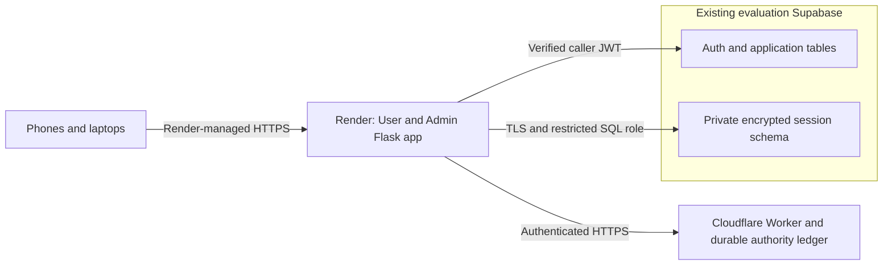

# Minimum remote evaluation infrastructure — initial proposal

Local implementation is now approved and prepared. See [the current candidate
and qualification report](README.md). Costs below remain proposals; no hosted
operation, provisioning or spending is approved.

Planning date: 2026-11-07. Target Supabase project jfaufpfzfhysqkhcdsrs only.
No deployment, services, billing subscription, hosted migration/settings change,
sign-in, commit or push is authorized or performed by this plan. Existing Linux
evidence and unconditional production startup refusal stay intact.

## Recommended architecture

One stateless paid Render web service hosts both existing Flask systems. Reuse
the evaluation project's PostgreSQL for encrypted session payloads in a private
schema. Add one separately managed Cloudflare Worker with a SQLite-backed Durable
Object as the authoritative session/recovery ledger. No Redis, new Render
Postgres, app persistent disk, background worker or second User/Admin web service
is needed initially. This is a proposal, not a qualified provider integration.

Two Gunicorn workers are the initial qualification target, with preload disabled
and pools constructed after fork. Session credentials, browser state, login/CSRF
challenges, pending/replay/rate state and logout receipts are shared durably;
separate namespaces/keys preserve User/Admin boundaries. Keep existing lifetime
bounds and encrypted, opaque browser handles. Never use a memory fallback.

## Can the evaluation PostgreSQL host sessions?

**Yes, conditionally, with logical separation—not independent failure isolation.**
Create a new unexposed schema such as rosago_session and a dedicated restricted
SQL role. Revoke PUBLIC/anon/authenticated/service_role access to that schema and
its objects; do not add it to exposed Data API schemas. The session role gets no
application/Auth/Storage table access, no superuser/BYPASSRLS/role-management
privileges and no broad DDL. Use a TLS-verified direct connection or the documented
session pooler/custom-role connection, bounded per-worker pools and reviewed grants.
Application queries continue using caller JWTs through the existing SDK clients,
never the session SQL role or service-role key.

Store encrypted session payloads, hashed opaque references, deadlines and
version/publication metadata there—no real plaintext passwords, token logs,
Auth-table copies or foreign keys that give session code access to Auth data.
Use bounded expiry cleanup within the app; a separate scheduled service is not
initially necessary. Retain revocation/version evidence for its reviewed lifetime.
Capacity and existing project tier must be checked before provisioning approval;
this plan does not presume a free/paid Supabase tier or unlimited resources.

The schema shares database outages/backups/restores with application/Auth data.
Therefore it cannot itself be the independent recovery authority. Do not simply
move the current local fixture tables to hosted PostgreSQL and call that secure.
The current PgRealm uses same-database history plus a recovery proof; it needs
per-record external metadata enforcement for this architecture.

References: [Supabase API boundaries](https://supabase.com/docs/guides/api/securing-your-api)
and [PostgreSQL connections/custom roles](https://supabase.com/docs/guides/database/connecting-to-postgres).

## Independent durable authority

Use one evaluation authority object for atomic multi-record transitions across
the required families and quotas, with explicit realm scoping. Its durable ledger
owns current incarnation/epochs, monotonically advancing revisions, ciphertext
digests, deadlines and terminal revocations. PostgreSQL payloads are accepted only
when they match that ledger before/after reads. Missing proof, stale payload,
unavailable authority or uncertain publication fails closed. Persist control state;
do not confuse a Worker restart or in-memory state with durable initialization.

HTTPS transport must validate the exact authority hostname/TLS certificate, use
an evaluation-only scoped application credential, bind nonce/namespace/realm/
incarnation on every operation, bound time/body/concurrency, and disable redirects
and automatic mutation retries. The Render app receives no Cloudflare account API
token and no authority restore/open/epoch-rotation permission. Keep operator
control credentials solely in the authority's separate management plane.

Never restore the authority ledger in place alongside a session DB snapshot.
Recovery blocks admission, drains workers/leases, creates a fresh authority
incarnation and User/Admin epochs where freshness is uncertain, invalidates old
sessions, then reopens only after checks. Restored application deployments cannot
choose old accepted bindings. A durable startup must not infer OPEN from database
contents or generate a new supposedly trusted authority automatically.

Cloudflare storage supplies a transactional durable building block, not an
automatic restore-security guarantee. Its own PITR must be excluded from ordinary
application credentials and covered by the above replacement/fencing procedure.
This implementation and failure protocol still need local and provider acceptance.

Reference: [Durable Object storage](https://developers.cloudflare.com/durable-objects/best-practices/access-durable-objects-storage/).

## Provider validation, logout and direct API access

1. Retain verified issuer/signature/subject/session checks on login and refresh.
   Add the reviewed caller-bound current-session helper, including session owner,
   exp/not_after and an explicit account/session policy. Do not grant client
   SELECT on auth.sessions or use get_user alone as revocation proof.
2. Apply restrictive session-liveness conditions alongside existing ownership/
   publication RLS and enforce the same condition inside privileged RPC
   entrypoints. Preserve all existing authorization checks. App-only checking
   and a PostgREST-only pre-request hook do not cover every API path.
3. On selected-realm logout, durably deny the app reference and record an encrypted
   logout receipt, then call provider scope=local for that exact session. Confirm
   acknowledgement or observed session absence before reporting complete provider
   logout. Unknown outcomes remain visibly unconfirmed; no blind retry, global
   signout or destruction of the only cleanup record.
4. A cryptographically valid old JWT must fail authenticated direct table/RPC
   access once its provider session is gone. Published anonymous destination
   reads remain intentionally public. Test replay against the provider API, not
   only browser-cookie replay. Authenticated GraphQL/other enabled paths must
   receive equivalent enforcement or be excluded under separate reviewed scope.
5. Database restoration can also roll back Auth/revocation data. Before approving
   recovery, qualify how provider API access and old JWTs are fenced throughout
   such a restore. Closing only Render is insufficient. Do not claim arbitrary
   restore-safe direct API access from the proposed session helper alone.

These are new evaluation-only SQL/RPC/RLS changes requiring a separate hash-
reviewed migration approval. The existing helper proposal is only a starting
point; it does not yet include all RLS/RPC protections or the full logout protocol.
No Auth/JWT lifetime or global settings change is presumed or performed.

References: [Supabase sessions](https://supabase.com/docs/guides/auth/sessions),
[signout](https://supabase.com/docs/guides/auth/signout),
[API security scope](https://supabase.com/docs/guides/api/securing-your-api).

## Render HTTPS, cookies and qualification

Render documents edge TLS termination and HTTP-to-HTTPS redirection. The selected
profile is managed-proxy, not direct-local-https. Use one exact Render-assigned
HTTPS hostname initially, host-only Secure/HttpOnly/SameSite=Lax cookies, User
Path=/ and separate Admin Path=/admin cookies. Cookie paths do not replace realm
and membership authorization. Keep Gunicorn's separate forwarded-header trust
disabled; the reviewed WSGI layer may trust only the verified scheme hop.

**Actual Render proxy sanitation is not verified yet.** After separately approved
quarantined deployment, test the real header path before setting the attestation:
plaintext redirect, forged Host/proto/forwarded Host/IP, exact canonical origin,
cookie issue/delete and access through the default Render hostname. Do not infer
header overwrite behavior solely from documentation of TLS termination.

Before respondent admission, qualify two workers, concurrent refresh/logout,
old-reference/JWT replay, worker kill/restart, app redeploy, authority restart,
stale/rolled-back session payloads and database/authority outages. No sticky sessions
are required. Temporary CAS 503 behavior already observed locally needs bounded
recovery and acceptable load/resource measurements; it is not a production pass.
Test Android Chrome, iPhone Safari and laptop browsers after the prior gates.

One shared limiter must work across workers/accounts; the ignored forwarded IP
is not a dependable respondent identity. Review direct provider signup/abuse
settings separately before opening access. Keep signup/mail/photo/paid integrations
outside this authentication plan; their disabled state does not qualify a complete
respondent website. Respondent provisioning/admission is a later approval.

Reference: [Render HTTPS/web services](https://render.com/docs/web-services).

## Services and indicative USD costs

| Component | Initial proposal | Monthly base |
| --- | --- | --- |
| Render | One paid web service, 512 MB candidate; both User/Admin, no disk | $7 |
| Independent authority | Cloudflare Workers Paid with one SQLite Durable Object | $5 subscription plus metered usage |
| Supabase | Reuse current evaluation project and capacity | Existing charges; no new instance assumed |
| Total additional base | Before usage, bandwidth, tax, currency conversion or upgrades | About $12/month |

Cloudflare SQLite Durable Objects also have a Free option, but its hard daily
quotas can deny operations; do not rely on it for the planned respondent window
without capacity evidence. Paid usage still needs limits and billing alerts;
alerts are not a guaranteed hard spending cap. If measured two-worker memory
does not fit 512 MB, Render's 2 GB tier is $25/month, raising this base to about
$30/month. Any upgrade needs separate approval. No cost is incurred by this plan.

Current official references: [Render pricing](https://render.com/pricing),
[Workers pricing](https://developers.cloudflare.com/workers/platform/pricing/),
[Durable Objects pricing](https://developers.cloudflare.com/durable-objects/platform/pricing/).

## Environment contract

Existing evaluation variables remain: ROSAGO_EVALUATION=true,
ROSAGO_EVALUATION_PROJECT_REF=jfaufpfzfhysqkhcdsrs,
SUPABASE_URL=https://jfaufpfzfhysqkhcdsrs.supabase.co,
SUPABASE_KEY=privately supplied pinned public key, ROSAGO_AUTH_MODE=production,
ROSAGO_EVALUATION_TRANSPORT=managed-proxy, ROSAGO_PUBLIC_ORIGIN=the final HTTPS
hostname, ROSAGO_EVALUATION_PROXY_HOPS=1 and
ROSAGO_PROXY_HEADERS_SANITIZED=true **only after actual validation**.
Keep ROUTING_PROVIDER=disabled and ROSAGO_EVALUATION_EMAIL_MODE=disabled.

Proposed new wiring, not currently implemented/activatable: backend=postgres via
ROSAGO_SESSION_BACKEND, scoped ROSAGO_SESSION_DATABASE_URL with verified TLS,
ROSAGO_AUTHORITY_URL, ROSAGO_AUTHORITY_CLIENT_TOKEN, ROSAGO_AUTHORITY_ID,
ROSAGO_AUTHORITY_INCARNATION and ROSAGO_AUTHORITY_MIN_SEQUENCE. Existing namespace,
User/Admin epoch, FLASK_SECRET_KEY and ROSAGO_SESSION_KEYRING variables require
fresh evaluation-only values. No production environment groups or bulk .env import.
Authority binding/credentials and its separate operator control key remain private.
Cloudflare deployment credentials are operator-only, never app runtime variables.
No Storage/service-role/JWT secrets or generic privileged DATABASE_URL is used.

## Minimal implementation and approval sequence

1. **Architecture decision, then local implementation:** build the authority,
   authenticated transport, externally fenced PG adapter and durable logout flow;
   prepare exact private-schema/RLS/RPC migrations. Test locally, preserving the
   startup refusal. No provisioning or hosted schema action is part of this step.
2. **Separate hosted-schema approval:** owner applies only the reviewed evaluation
   bundle; verify with the unchanged read-only evaluation MCP. No production access.
3. **Separate paid provisioning/deployment approval:** approve exact resource names,
   region, private credentials, cost scope and manually deployed authority/closed
   Render candidate. Creating these services can trigger deployment; do not attempt
   a supposedly provisioning-only shortcut under the present no-deploy restriction.
4. **Separate controlled live-test approval:** two existing synthetic accounts,
   bounded login/read/negative-Admin/logout/replay and approved failure exercises;
   fix any failures before opening respondent access.
5. **Separate respondent admission approval:** qualified mobile/laptop acceptance,
   account distribution, time window, monitoring and explicit shutdown/revocation
   plan. No Google Forms, questionnaire feature or extra evaluation UI is added.

Architecture adoption and local implementation were provisionally approved.
The current next hosted approval and unresolved gates are listed in README.md.
The $12/month base remains a later provisioning proposal, not a charge
authorization or total bill cap.
